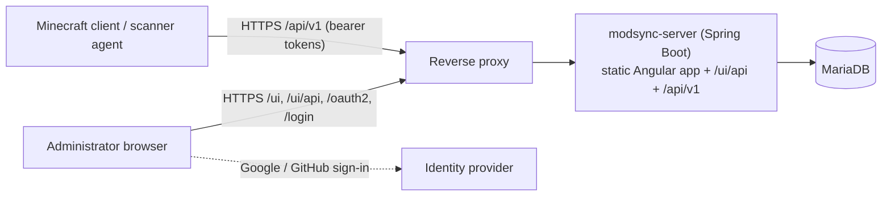

# Architecture

`modsync-domain` defines UUID-compatible identities, evidence, classifications, dependency constraints, artifacts, immutable manifests and explainable operations. `modsync-protocol` owns versioned wire messages, HTTPS transport and atomic local configuration writes. Neither depends on Spring.

`modsync-scanner` reads ZIP/TOML/JSON metadata and hashes files sequentially. It never executes JARs, extracts archives, follows mod symlinks, or edits server storage. It rejects malformed metadata and observable directory/file changes rather than publishing partial results. Hashes are currently recomputed per scheduled scan; persistent hash caching remains an optimization.

`modsync-modrinth` batches SHA-512 identification, retrieves project/version/dependency metadata and lists compatible versions. Requests have timeouts, bounded response sizes, caching and bounded rate-limit retries. Cache state is currently in memory.

`modsync-resolver` merges exact required server artifacts with approved client-only profile artifacts. It checks exact pins, loader/game compatibility, required/incompatible dependencies, filename collisions and management ownership. Cycles terminate because the complete pinned set is validated without recursive execution. Embedded providers participate in dependency checks; `--include-optional` selects server optional artifacts. Missing dependency versions block the plan; the initial implementation does not choose arbitrary versions on behalf of an administrator.

`modsync-agent` provides enrollment, local mapping configuration, scans, scheduled outbound requests, staged uploads and committed acknowledgements. Pending snapshots and progress survive process failure. One state-directory lock prevents competing scan processes.

`modsync-server` owns Spring Security, JDBC transactions, Flyway, MariaDB, ownership fencing, profile authorization, immutable manifest publication, audit events and Actuator/Micrometer. Client instance inventories (client_instance_inventory, client_instance_mods) and publication history/policy (publication_history, minecraft_servers.publication_policy) are persisted; catalog caching remains reserved.

`modsync-client` uses Picocli, Java HTTP and NIO. A per-instance lock, deterministic plan, staged downloads, SHA-512/CRC checks, backups and an installation journal support recovery. It verifies online authority immediately before apply. Only the latest transaction is directly rollback-addressable; retained backup directories require an eventual retention policy. Atomic file replacement is used; power-loss durability across all filesystems has not been established.

`modsync-client-tui` adds JLine as a separate JVM application. The standard client has no GUI/JLine dependency. `modsync-test-fixtures` provides deterministic synthetic JAR construction.

No component uses a shared cross-host mount, database access from a client, Docker socket, or an inbound scanner API. Initial protocol version is 1 and minimum component compatibility is 0.2.0 (the server rejects older `X-ModSync-Version` values with 426). See API documentation for limits and failure behavior.

## Package layout

Every module uses the base package `de.alexandermora.modsync.<module>` (for example `de.alexandermora.modsync.domain`, `de.alexandermora.modsync.protocol`). `modsync-server` is split into feature packages: `auth`, `agent`, `inventory`, `manifest`, `profile`, `catalog`, `system`, `common`, `config` and `observability`, plus `ui` (static application serving, the dashboard security chain and the JSON API in `ui.api`), `sso` (Google and GitHub sign-in), `users` (administrator user management), `publication` and `clientinventory`. Each feature owns its controller (thin, typed request bodies, returns DTOs directly rather than `ResponseEntity`) and its service. See `docs/GUIDE.md` for details.

Instance registration requires explicit game/loader metadata, checked against manifests during planning/apply/verify. This metadata must match the actual launcher configuration; ModSync does not install the game/loader or claim to detect every launcher. Verified artifact hashes are recorded separately from managed ownership so pre-existing required files are checked without being adopted for later deletion.

## Automatic mod management

- **Toolchain:** Kotlin 2.4.21 on JVM 25 with Spring Boot 4.1.2 and Gradle 9.9.1; all modules compile and test on this combination, and Dokka 2.3.0, Detekt 2.0.0-alpha.6, Spotless/ktlint and SonarScanner 7.5 run on it. Stable Detekt 1.23.8 does not run on JDK 25, which is why the alpha line is used (see `docs/development/CODE_QUALITY.md`).
- **Server publication:** after an agent commits a snapshot, `publication.AutoPublicationService` evaluates the server's policy (`MANUAL`, `REVIEW_UNKNOWN`, `TRUSTED_AUTO`) on one background thread. Only artifacts with an approved or trusted-project classification, identified by exact hash, can publish; anything else is queued as `REVIEW_REQUIRED`. The normal `ManifestService.preview/publish` path validates dependencies and compatibility, so automatic and manual publication share all invariants. A manifest whose client-relevant requirements equal the latest revision is skipped, so no duplicate revisions exist.
- **Client inventory and coverage:** `clientinventory` stores per-instance inventories (hashes, file names, recognized project/version ids, managed flag, applied revision, policy, activity, personal profile) reported with a per-instance sequence (higher replaces, equal is an idempotent retry, lower is stale). `domain.computeCoverage` compares exact SHA-512 hashes and is combined with freshness (15 min online window, 24 h stale limit) to yield the status matrix with two queries per server.
- **Client automation:** `modsync auto` is opt-in per instance. `AutoSyncRunner` checks the cheap published revision first, then reuses `Resolver` and `Installer` unchanged; policy gates which operations may run, a running game defers installation, and every pass uploads an inventory. No broker or resident service is introduced; OS schedulers call `auto run --once`.
- **Dashboard:** the Angular application in `frontend/` is built into the server jar and served under `/ui`. `ui.api.UiApiController` exposes JSON under `/ui/api` over the same services behind a separate session/CSRF filter chain for administrators (see *Administration interface* below).
- **User management:** `ui.api.UiApiController` exposes the user endpoints under `/ui/api/users` and delegates to `users.UserManagementService`, which holds the rules (CLIENT accounts only, row lock plus audit per change, sealed `UserCommandResult`). It reuses `AuthService.createUser`, the shared `auth.AccountPolicy` and `common.MaintenanceMode`, and depends on the small `UserSessionRevoker` interface that `ui.RegistryUserSessionRevoker` implements with Spring's `SessionRegistry`. Account status (`users.enabled`) is enforced in `AuthService`, the API `Guard` and the dashboard authentication provider.

## Administration interface

- **One runtime artifact.** `frontend/` (Angular, strict TypeScript, standalone components, signals, OnPush, lazy routes) is built by npm during the Gradle `processResources` task and packaged under `static/ui` in `modsync-server.jar`. There is no Node.js at runtime and no extra container. See [frontend development](docs/development/FRONTEND.md).
- **Routes.** `/ui/**` static application and client-side routes (an explicit allow-list), `/ui/api/**` session-protected JSON, `/api/v1/**` the unchanged bearer-token API for clients and agents, `/login`, `/logout`, `/oauth2/authorization/{id}` and `/login/oauth2/code/{id}` for sign-in.
- **Responsibilities.** Angular renders, navigates and calls the API; Spring Boot authenticates, authorizes, validates, audits and persists. Angular never makes an authoritative decision.
- **Authentication sequence.** Password sign-in posts a plain form to `/login`; provider sign-in is the OAuth2 authorization-code flow drawn in the [SSO guide](docs/security/SSO_SETUP.md#1-introduction). Both end in the same kind of session principal: the account id with its stored role.
- **Single-sign-on data.** `external_identities` (migration V6) links `(provider, subject)` to a user; see [DATABASE.md](DATABASE.md).
