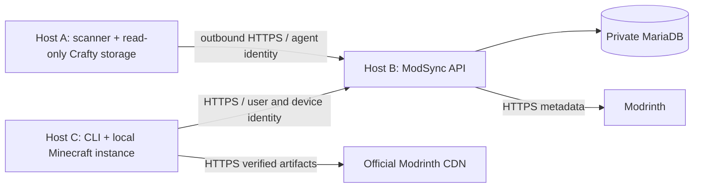

# Distributed architecture

A and C never connect to each other. Only B talks to MariaDB. A runs no listener. All network endpoints are explicit configuration; stable application identities are UUIDs, never addresses or paths.

Hosts, agents and logical Minecraft servers are separate records. An administrator assigns a server to an agent and a local mapping alias. Transfer increments ownership generation and resets that generation's submission sequence. Prior committed snapshots and manifest revisions remain. Similar file inventories never merge server identities.

An inventory has a scan UUID, generation, sequence, timestamp, digest and expected entry count. B stages idempotent indexed batches, rejects conflicting retries and commits only a complete unique filename set with the expected digest. A keeps pending state until it receives the committed acknowledgement. Stale submissions cannot replace newer accepted state. Identical successful rescans refresh inventory freshness through authenticated confirmations without resending entries.

A lost enrollment acknowledgement can be retried using the same still-valid token and same agent UUID; this replaces that enrollment's undelivered credential. The token cannot enroll a different UUID. Routine reconnection uses the agent credential; it never requires the enrollment token.

Client devices belong to users. Profiles belong to users, not devices. New clients register separate UUIDs and retrieve existing profiles. Endpoint updates preserve local identities; a different control-plane UUID requires explicit trust and clears old endpoint credentials.

The deterministic integration harness uses separate A-B and C-B networks and separate filesystems. It provides a trusted fixture CA, synthetic Modrinth API/CDN, independent MariaDB restore target and replacement backend. The harness is implemented but has not executed in the current sandbox.
