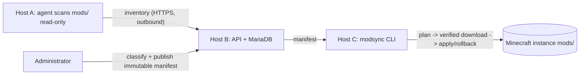

# Minecraft ModSync

Self-hosted mod inventory and client reconciliation across three independent hosts.

**Status: JVM and distributed integration validated; not a production release.** GitHub CI has passed compilation, MariaDB tests and the three-host HTTPS/migration/restore fixture on Linux amd64. Final scan ordering is being corrected; native/platform, production security and release gates remain open. See [MEMORY.md](MEMORY.md) for evidence.

- **Host A:** a read-only scanner agent beside existing Crafty-managed storage; outbound HTTPS only.
- **Host B:** Spring Boot API, immutable manifests, user profiles and MariaDB.
- **Host C:** Kotlin/Picocli client, with a separate optional JLine terminal distribution. No Spring, database server or resident client daemon.

One monorepo produces independently deployable artifacts. Minecraft worlds, Crafty configuration and launcher files are never managed by ModSync.

## How it works (30-second version)



1. The **agent** hashes every JAR on the server and uploads a complete, fenced inventory.
2. An **administrator** approves a classification per mod and publishes a numbered manifest of exact Modrinth versions.
3. Each player's **client** builds a plan (install/update/keep/remove managed/skip unmanaged), downloads only from the official CDN with SHA-512 and CRC checks, applies atomically with backups, and can roll back.

Want the exact commands? See the [command runbook](docs/USAGE.md). New here? Read the full step-by-step [project guide](docs/GUIDE.md): glossary, module map, auth and sync sequence diagrams, resolver rules, database schema, deployment and CI.

## Build and verification

Install JDK 25, Python 3, network access to Gradle/Maven repositories, and Docker daemon access for Testcontainers. The local environment only supplied Java 26.

```sh
./gradlew check :modsync-server:bootJar :modsync-agent:installDist :modsync-client:installDist :modsync-client-tui:installDist
python3 scripts/check-architecture.py
python3 scripts/openapi.py --check
python3 -m unittest discover -s scripts/release -p 'test_*.py'
python3 scripts/integration/distributed.py
```

`gradlew` currently uses a Python bootstrap with a pinned Gradle distribution checksum. It is **not** the official wrapper JAR; generating and checking in the official wrapper remains a release gate. Windows can use `gradlew.bat`. Do not disable certificate verification to obtain dependencies.

Native build: use GraalVM Community 25 and `./gradlew :modsync-client:nativeCompile :modsync-agent:nativeCompile`. Native execution and reflection configuration still need runner verification. JVM distributions provide a fallback.

## Deployment and first sync

1. Deploy Host B using [docker/server/README.md](docker/server/README.md), configure HTTPS and bootstrap the administrator.
2. Obtain `/api/v1/info` through verified HTTPS; record the control-plane UUID independently.
3. Enroll Host A following [docker/agent/README.md](docker/agent/README.md). Explicitly create logical servers and assign local mapping aliases.
4. Review accepted inventory, identify artifacts, approve classifications and publish a validated manifest through the administrator API. Unknown/private artifacts require a manual policy.
5. On Host C, extract the JVM client distribution and run its `bin/modsync-client` launcher (or a verified native `modsync` binary).

```sh
modsync setup --server-url https://modsync.example.net
modsync login --username player
modsync instances discover
modsync instances add game /path/to/game-directory --minecraft-version 1.21.1 --loader neoforge
modsync servers list
modsync sync plan --instance game --server SERVER_UUID --out plan.json
modsync sync apply --instance game --plan plan.json --dry-run
modsync sync apply --instance game --plan plan.json
modsync sync verify --instance game
```

Setup prompts for control-plane trust on a console. Automation must supply `--trust-server-id UUID` after independent verification. Close Minecraft before applying or rolling back changes. Explicitly record the actual installed Minecraft/loader versions when adding an instance; provide `--loader-version` when the selected server pins it. Launcher version installation/detection is not automated.

The CLI also supports `config show`, `config set server-url URL`, `connection test`, `mods scan`, `mods list`, `personal list`, `personal import`, `sync cached`, `sync rollback` and `doctor`. Use `--help` within command groups. Extract the separate TUI distribution, then run `modsync interactive --tui-home /path/to/modsync-client-tui` (requires Java 25), or use its `bin/modsync-client-tui` launcher. Add `--include-optional` to `sync plan` to select server optional mods.

Offline scans and diagnostics do not authenticate or claim current synchronization. Online apply always re-authenticates and compares the exact published manifest. Matching pre-existing unmanaged files remain unmanaged.

## Automatic synchronization, inventory and dashboard

Players can opt in per instance with `modsync auto enable` (see [usage](docs/USAGE.md)); the client then installs approved changes only while Minecraft is closed, keeps personal and unmanaged mods, and reports its verified inventory to Host B. Administrators see server mods, client coverage and publication history at `/ui` on Host B and can choose an automatic publication policy per server. Quality tooling (Detekt, Spotless, Dokka, JaCoCo, SonarQube) is described in [code quality](docs/development/CODE_QUALITY.md) and [SonarQube](docs/development/SONARQUBE.md).

## Documentation

[**Project guide**](docs/GUIDE.md) · [**Command runbook**](docs/USAGE.md) · [Architecture](ARCHITECTURE.md) · [Distributed topology](DISTRIBUTED_ARCHITECTURE.md) · [Networking](NETWORKING.md) · [Migration](HOST_MIGRATION.md) · [Database](DATABASE.md) · [Docker](DOCKER.md) · [Security](SECURITY.md) · [Release process](RELEASES.md) · [Performance](CLIENT_PERFORMANCE.md) · [Repository strategy](REPOSITORY_STRATEGY.md) · [API](docs/architecture/API.md) · [Kotlin guidelines](docs/development/KOTLIN_GUIDELINES.md)

[Implementation report](IMPLEMENTATION_REPORT.md) covers delivered source, actual checks and remaining release gates.
