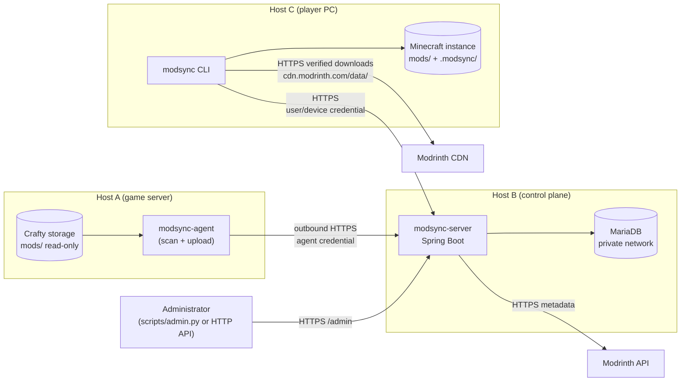
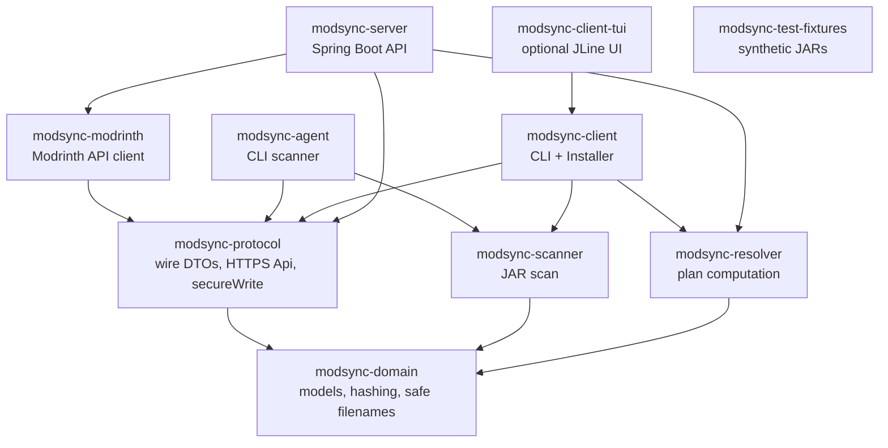
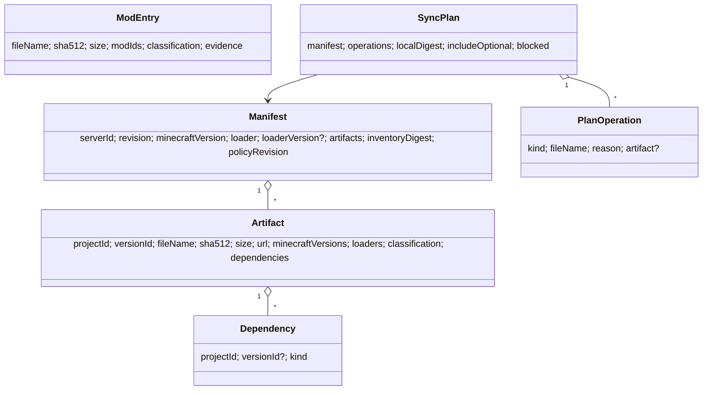
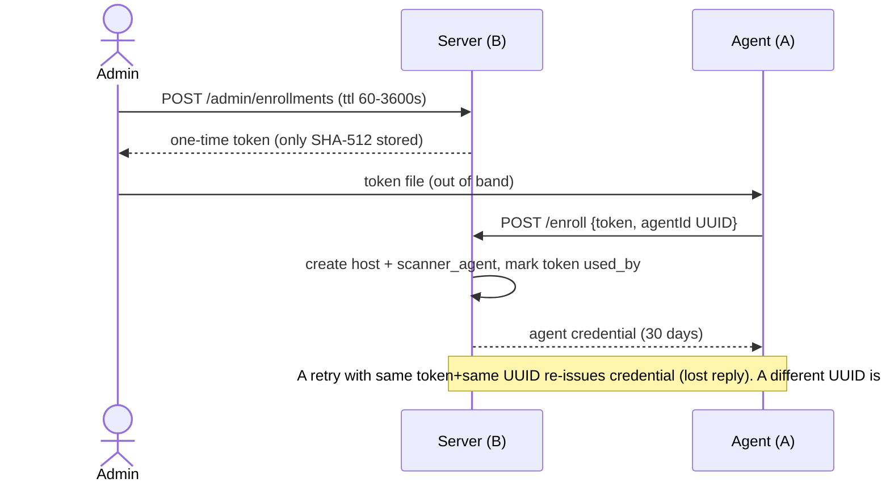
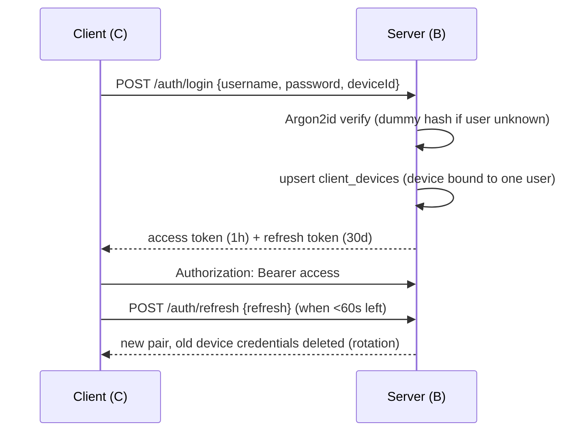
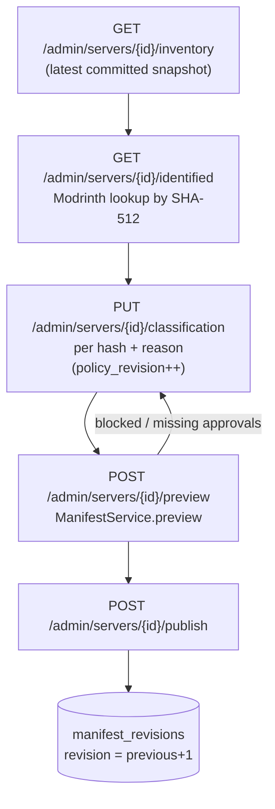
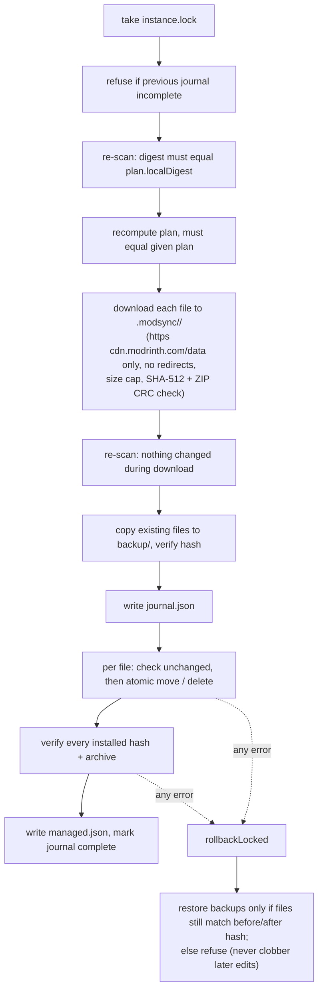
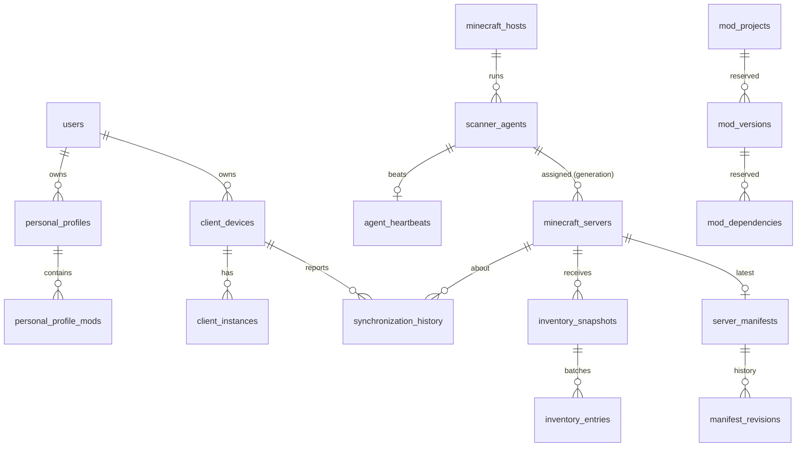
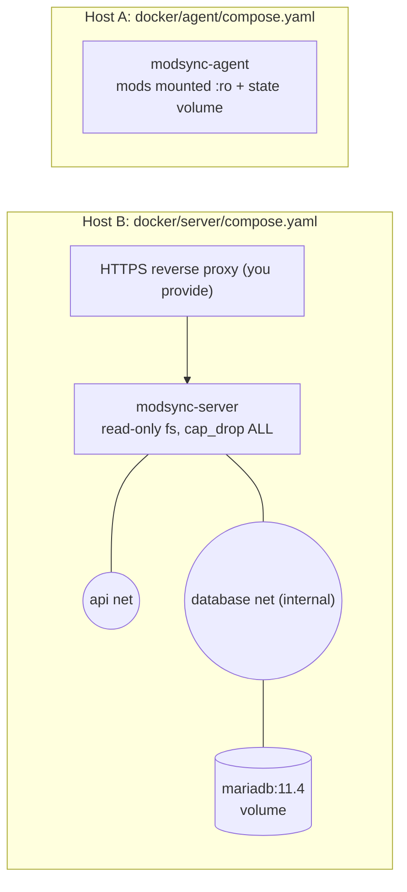
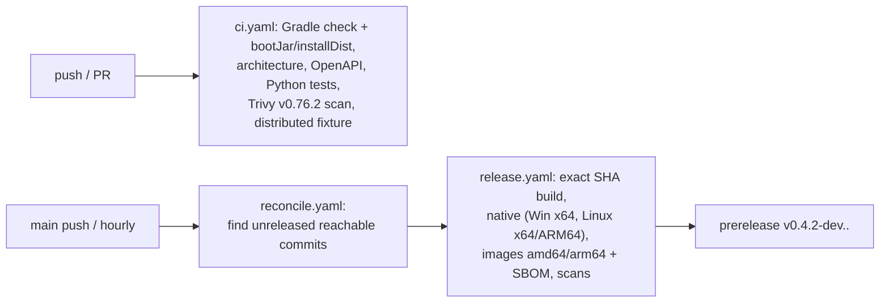

# ModSync project guide (start here)

A step-by-step explanation of what ModSync is, how its parts fit together and how data moves through it. Everything below was derived from the source code; file names are given so you can follow along. Project status caveats live in [MEMORY.md](../MEMORY.md) — this is an initial implementation, not a production release. For the exact commands to run, see the [command runbook](USAGE.md).

## Contents

1. [The problem and the idea](#1-the-problem-and-the-idea)
2. [Glossary](#2-glossary)
3. [Big picture: three hosts](#3-big-picture-three-hosts)
4. [Repository and module map](#4-repository-and-module-map)
5. [Core data model](#5-core-data-model)
6. [Trust and authentication](#6-trust-and-authentication)
7. [Flow 1 — Host A uploads an inventory](#7-flow-1--host-a-uploads-an-inventory)
8. [Flow 2 — Administrator classifies and publishes a manifest](#8-flow-2--administrator-classifies-and-publishes-a-manifest)
9. [Flow 3 — Host C plans and applies a sync](#9-flow-3--host-c-plans-and-applies-a-sync)
10. [The resolver rules](#10-the-resolver-rules)
11. [Database schema](#11-database-schema)
12. [Server internals](#12-server-internals)
13. [Deployment](#13-deployment)
14. [Build, test, CI and releases](#14-build-test-ci-and-releases)
15. [Security summary](#15-security-summary)
16. [Known limitations](#16-known-limitations)
17. [Where to read next](#17-where-to-read-next)

## 1. The problem and the idea

A Minecraft server (managed by Crafty) has a `mods/` folder. Players need a matching set of client-side mods, and must not break their own extra mods (shaders, minimaps…).

ModSync solves this by:

1. **Scanning** the server's mods (SHA-512 of each JAR + metadata) from a read-only agent.
2. Storing the inventory in a central **control plane** (API + MariaDB).
3. Letting an **administrator** approve a classification for every mod (server-only, client-required, optional…) and **publish an immutable manifest** pinning exact versions from Modrinth.
4. Letting each **player's CLI** compare the manifest with the local instance, build a **plan**, download verified files, and apply them with backups and rollback.

Guiding principles: nothing is executed or guessed; every file is pinned by hash; clients/agents only make outbound HTTPS calls; unmanaged player files are never deleted.

## 2. Glossary

| Term | Meaning |
|---|---|
| Control plane / Host B | Spring Boot API + MariaDB. Has a persistent UUID (`control_plane_id`). |
| Agent / Host A | Outbound-only scanner next to Crafty storage. |
| Client / Host C | `modsync` Picocli CLI on the player's PC. |
| Logical server | A Minecraft server record (`minecraft_servers`), independent of host or path. |
| Mapping alias | Name (e.g. `survival`) that the agent maps locally to a real `mods/` directory. Paths never leave Host A. |
| Generation | Counter bumped on every (re)assignment of a server to an agent; fences stale agents. |
| Sequence | Per-generation counter of inventory submissions; rejects outdated scans. |
| Snapshot / inventory | One complete scan result (`scanId`, digest, entries). |
| Classification | `SERVER_ONLY, CLIENT_REQUIRED, CLIENT_OPTIONAL, CLIENT_ONLY, BOTH_REQUIRED, UNKNOWN`. |
| Artifact | An exact pinned mod file: project id, version id, filename, SHA-512, size, CDN URL, compat sets, dependencies. |
| Manifest | Immutable, numbered revision listing all artifacts for a server. |
| Personal profile | A player's own client-only mods (must be Modrinth projects declaring server side unsupported). |
| Plan | List of operations the client would do: `INSTALL, UPDATE, KEEP, DISABLE, REMOVE_MANAGED, SKIP, CONFLICT, MANUAL_ACTION_REQUIRED`. |
| Managed file | A file ModSync installed and recorded (name → hash). Only managed files may be removed/overwritten. |
| Journal | Client record of an in-progress install, used for rollback. |

## 3. Big picture: three hosts



Rules enforced by design: A and C never talk to each other; only B talks to MariaDB; A runs no listener; no shared mounts; no Docker socket.

## 4. Repository and module map

Ten Gradle modules (`settings.gradle.kts`), all Kotlin, one root package per module (`de.alexandermora.modsync.domain`, `.protocol`, `.scanner`, `.resolver`, `.modrinth`, `.agent`, `.client`, `.client.tui`, `.server`, `.fixtures`), JDK 25.


*(Edges mirror each module's `build.gradle.kts`; `scripts/check-architecture.py` enforces the boundaries. Server tests, client and scanner tests also use `modsync-test-fixtures`.)*

| Module | Key file | What it does |
|---|---|---|
| domain | `Domain.kt` | `ModEntry`, `Artifact`, `Manifest`, `SyncPlan`, `sha512`, `safeFileName` (rejects path separators, reserved Windows names, non-`.jar`), `inventoryDigest` (SHA-512 over sorted `name\0hash\0size`). |
| protocol | `Protocol.kt`, `Transport.kt` | Wire messages (protocol version 1, component 0.2.0). `Api` enforces HTTPS only, no redirects, 8 MiB response cap, headers `X-ModSync-Protocol/Version`. `secureWrite` = temp file + atomic move, mode 0600 on POSIX. |
| scanner | `Scanner.kt` | Lists `*.jar`, refuses symlinks, hashes with SHA-512, reads `neoforge.mods.toml`, `mods.toml`, `fabric.mod.json`, `jarjar/metadata.json` (≤1 MiB each, 2 MiB total), extracts mod ids, flags duplicate hashes/ids, aborts if a file or the directory changes during the scan. Never executes JARs. |
| resolver | `Resolver.kt` | Pure function `plan(manifest, personal, local, managed, includeOptional)` → `SyncPlan`. Also used by the server to validate manifests before publishing. |
| modrinth | `Modrinth.kt` | Hash lookup (`version_files`, batches of 100), project/version, compatible versions. 1-hour in-memory cache, retries on 429/5xx with jitter, size/timeouts. |
| agent | `Agent.kt` | Commands `setup, register, map, scan, run, status, doctor`. |
| client | `Client.kt`, `Installer.kt` | Commands `setup, login, config, connection, servers, instances, mods, personal, sync, doctor, interactive`. |
| server | `de.alexandermora.modsync.server.{auth,agent,inventory,manifest,profile,catalog,system,common,config,observability}` | REST API, auth, persistence, publishing; each feature has its controller, service and persistence. |
| tui | `Interactive.kt` | Separate JVM app so the normal client stays JLine-free. |
| fixtures | `Fixtures.kt` | Builds fake JARs for tests. |

Outside modules: `docker/` (server, agent, dev compose), `scripts/` (Python: `admin.py`, backups, release, integration harness, OpenAPI generation, architecture check), `.github/workflows/` (CI, release, reconcile), `docs/` and root `*.md`.

## 5. Core data model



`ModEntry` is what the *scanner* sees (local files). `Artifact` is what the *manifest* pins (Modrinth-verified or manually approved). The resolver compares the two.

## 6. Trust and authentication

### 6.1 Control-plane identity (trust on first use, explicit)
On first start the server stores a random UUID in `system_settings.control_plane_id` and exposes it at `GET /api/v1/info`. `modsync setup` / `modsync-agent setup` fetch it and require the user to confirm it (typing it, or `--trust-server-id`). It is saved in the local config; every later call re-checks that the UUID still matches, otherwise it aborts ("Control-plane identity changed").

### 6.2 Agent enrollment



### 6.3 User login and tokens



- Tokens are 256-bit random values; only their SHA-512 is in table `credentials`.
- Roles: `ADMIN` (bootstrap user from `MODSYNC_BOOTSTRAP_PASSWORD_FILE`), `AGENT`, `CLIENT`.
- Agents rotate their credential when under 24 h remain.
- Revoking an agent/device deletes its credentials and blocks future use.

## 7. Flow 1 — Host A uploads an inventory

Admin prepares once: create server (`POST /admin/servers`), then assign it to an agent with a mapping alias (`PUT /admin/servers/{id}/assignment`, which does `generation = generation + 1, sequence = 0`). On Host A: `modsync-agent map <alias> <mods dir>`.

```mermaid
sequenceDiagram
  participant Ag as Agent
  participant FS as mods/ (read-only)
  participant S as Server
  loop every interval (default 300s, jittered; backoff on failure, stops after 8)
    Ag->>Ag: take state-dir lock (one scan at a time)
    Ag->>S: POST /agent/heartbeat
    Ag->>S: GET /agent/assignments
    Ag->>FS: Scanner.scan (SHA-512, metadata)
    alt digest == last acknowledged digest (same generation)
      Ag->>S: heartbeat with ScanConfirmation (refresh freshness only)
    else changed
      Ag->>Ag: write pending-<server>.json (survives crashes)
      Ag->>S: POST /agent/snapshots (scanId, generation, sequence, digest, count)
      Ag->>S: PUT /agent/snapshots/{id}/batches (1 entry each, idempotent)
      Ag->>S: POST /agent/snapshots/{id}/commit
      S->>S: verify count, unique names, digest recompute, sequence > current
      S-->>Ag: SnapshotAck
      Ag->>Ag: write progress-<server>.json, delete pending
    end
  end
```

Safety properties (see `InventoryService` and `AgentService`):
- `ownership()` locks the server row and checks `agent_id` and `generation`; a stale agent after a transfer is rejected.
- Re-sending the same `begin`/batch is accepted only if byte-identical (otherwise 409 "Conflicting retry").
- A snapshot is only visible after `commit`; partial uploads never replace the accepted state. Payload cap 6 MiB per snapshot, max 10 000 files.
- Agents surface in the admin list with a heartbeat; >15 min is "stale".

## 8. Flow 2 — Administrator classifies and publishes a manifest



`ManifestService.preview` requires:
1. The request's `scanId` is the server's latest committed snapshot.
2. **Every** scanned file has an explicit classification override.
3. Every artifact is either rebuilt from Modrinth by hash (URL present) or is a *manual* artifact matching the scanned file (no URL; clients must supply the exact file locally).
4. Every scanned file is accounted for; no duplicate project pins.
5. Running the resolver on the candidate (with optional mods) yields no `CONFLICT`/`MANUAL_ACTION_REQUIRED` — i.e. dependencies and game/loader compatibility hold.

`publish` re-checks under a row lock (`policy_revision` and revision unchanged) and writes the next immutable revision plus an audit event. Old revisions are retained.

## 9. Flow 3 — Host C plans and applies a sync

### 9.1 One-time setup

```sh
modsync setup --server-url https://modsync.example.net        # confirm control-plane UUID
modsync login --username player
modsync instances add game /path/to/game --minecraft-version 1.21.1 --loader neoforge
```
`instances add` writes `<instance>/.modsync/instance.json`. The manifest's Minecraft/loader (and loader version if pinned) must equal it, otherwise planning stops — ModSync does not install the game or loader.

### 9.2 Plan then apply

```mermaid
sequenceDiagram
  participant U as Player
  participant C as modsync
  participant S as Server
  participant CDN as cdn.modrinth.com
  U->>C: sync plan --instance game --server UUID --out plan.json
  C->>S: GET /servers/{id}/manifest (latest)
  C->>C: lock instance, Scanner.scan(mods), Resolver.plan
  C-->>U: operations + reasons (plan.json saved; error if blocked)
  U->>C: sync apply --plan plan.json [--dry-run]
  C->>S: re-fetch manifest, must equal plan.manifest
  C->>S: re-fetch personal profiles, must still authorize client-only items
  C->>C: Installer.apply (below)
  C->>S: POST /sync/reports SUCCESS (best effort)
  U->>C: sync verify
  C->>S: compare local hashes AND current manifest
```

### 9.3 What `Installer.apply` does



State on Host C lives in `<instance>/.modsync/` (`instance.json`, `managed.json`, `journal.json`, `<id>/backup`, `instance.lock`) and in `~/.modsync/` (`config.json`, cached manifests). `sync rollback` undoes only the latest transaction.

Offline commands (`mods scan`, `doctor`, `sync cached`) never authenticate and never claim "current".

## 10. The resolver rules

`Resolver.plan` decides per file (in order of importance):

| Situation | Operation |
|---|---|
| Server artifacts with `CLIENT_REQUIRED`/`BOTH_REQUIRED` (+ `CLIENT_OPTIONAL` with `--include-optional`) plus personal artifacts are the *desired* set | — |
| Same project, different version/hash across sources | `CONFLICT` |
| Personal artifact not `CLIENT_ONLY` | `CONFLICT` |
| Manifest artifact still `UNKNOWN` | `MANUAL_ACTION_REQUIRED` |
| Two artifacts → same filename (case-insensitive) | `CONFLICT` |
| Unsafe name / bad hash / wrong MC version or loader | `CONFLICT` |
| Required dependency missing (or wrong pinned version); incompatible dependency present | `CONFLICT` |
| Embedded (jar-in-jar) providers count as satisfying a dependency | — |
| Local file has identical hash | `KEEP` |
| Local file differs and is not managed (or case differs) | `CONFLICT` (would overwrite) |
| No download URL (private mod) | `MANUAL_ACTION_REQUIRED` |
| Otherwise | `INSTALL` (new) / `UPDATE` (exists, managed) |
| Local file not desired and managed | `REMOVE_MANAGED` |
| Local file not desired and unmanaged | `SKIP` (preserved) |

A plan is `blocked` if it has any `CONFLICT` or `MANUAL_ACTION_REQUIRED`. The resolver never picks versions for you: missing pins block instead.

## 11. Database schema

Single Flyway migration `V1__initial.sql` (MariaDB 11.4, InnoDB, utf8mb4).



Standalone tables: `system_settings` (control_plane_id), `credentials` (hashed tokens, `kind` access/refresh), `agent_enrollments`, `classification_overrides` (server_id + sha512 → classification, reason), `audit_events`. Tables `mod_projects/versions/dependencies` and `client_instances` exist but are currently reserved (not populated).

## 12. Server internals

- **Entry**: `ServerApplication` (`ServerApplication.kt`): inserts control-plane id, bootstraps the admin from a protected password file (16–256 chars) only if no users exist.
- **Security chain** (`Security.kt`): stateless, CSRF/CORS off. Public: `/info`, `/auth/login`, `/auth/refresh`, `/enroll`, health. `/admin/**` + Prometheus → ADMIN; `/agent/**` → AGENT; rest of `/api/v1/**` → CLIENT or ADMIN; everything else denied.
- **`Guard` filter**: correlation id header per request; maintenance mode (`MODSYNC_MAINTENANCE`) rejects non-GET with 503; 20 req/min/IP on login/refresh/enroll (429); requires matching protocol and ≥ component version headers (426); body ≤ 2 MiB (413); looks up bearer token hash, checks agent/device not revoked.
- **Controllers** (one per feature package) are thin: they take typed request bodies and return DTOs directly (no `ResponseEntity`); the kotlinx-serialization converter uses the shared `wire` format and `common/Support.kt`'s `Errors` advice maps invalid input to a 400 `Failure`. **Services** hold the transactions (`CredentialService`, `AuthService`, `AgentService`, `InventoryService`, `ManifestService`, `ProfileService`, `CatalogService`); `observability/Observability.kt` is Micrometer/Actuator.
- **API reference**: [docs/architecture/API.md](architecture/API.md), generated `openapi.json` (`scripts/openapi.py --check` in CI).
- **Config** (`application.yaml`): `MODSYNC_DB_URL/USER/PASSWORD`, bootstrap user/password file, maintenance, ECS-format structured logs, Hikari pool 5.

## 13. Deployment



1. **B**: create secrets dir (`db_password`, `db_root_password`, `bootstrap_password`), set `MODSYNC_SECRETS_DIR`, `docker compose up`, put a trusted HTTPS proxy in front. See [docker/server/README.md](../docker/server/README.md).
2. Read the control-plane UUID from `/api/v1/info`.
3. **A**: `setup --server-url … --trust-server-id UUID`; admin creates an enrollment token; `register --enrollment-token-file …`; `map <alias> /mods`; admin creates server + assigns; `run`. See [docker/agent/README.md](../docker/agent/README.md).
4. Admin classifies and publishes (Flow 2).
5. **C**: install the JVM distribution (or a native build) and follow Flow 3.

Operations: backups/restore via `scripts/backup/*.sh` ([DATABASE.md](../DATABASE.md)); moving hosts: [HOST_MIGRATION.md](../HOST_MIGRATION.md); networking options: [NETWORKING.md](../NETWORKING.md).

## 14. Build, test, CI and releases

Local (JDK 25, Python 3, Docker for Testcontainers):

```sh
./gradlew check :modsync-server:bootJar :modsync-agent:installDist :modsync-client:installDist :modsync-client-tui:installDist
python3 scripts/check-architecture.py
python3 -m unittest discover -s scripts/release -p 'test_*.py'
python3 scripts/integration/distributed.py   # 3-host TLS fixture
```

Tests: Kotlin unit tests (scanner, resolver, transport, installer) and MariaDB integration tests in `modsync-server`.


Details: [RELEASES.md](../RELEASES.md).

## 15. Security summary

- HTTPS only, no redirects, explicit control-plane UUID pin.
- Argon2id passwords; hashed opaque tokens; rotation; revocation.
- Agents are read-only, outbound-only; assignment generation fencing.
- Downloads: only `cdn.modrinth.com/data/`, exact SHA-512 and ZIP CRC, size caps.
- Filesystem: unsafe names, symlinks, scan races and unmanaged collisions rejected; locks and journals; no overwrite of later local edits.
- JARs are never executed or extracted by the tooling.
- Full model and gaps: [SECURITY.md](../SECURITY.md).

## 16. Known limitations

No official Gradle wrapper JAR yet, native builds unverified, no Crafty API adapter, in-memory Modrinth cache, hashes recomputed every scan, no per-server ACLs/MFA, Windows ACL hardening and power-loss durability open, backups of old transactions have no retention policy, no automatic version selection. Authoritative list: [MEMORY.md](../MEMORY.md) and [IMPLEMENTATION_REPORT.md](../IMPLEMENTATION_REPORT.md).

## 17. Where to read next

| If you want to… | Read |
|---|---|
| Understand module boundaries | [ARCHITECTURE.md](../ARCHITECTURE.md) |
| Understand multi-host protocol rules | [DISTRIBUTED_ARCHITECTURE.md](../DISTRIBUTED_ARCHITECTURE.md) |
| Call the API | [docs/architecture/API.md](architecture/API.md) |
| Deploy | [docs/deployment/README.md](deployment/README.md) |
| Review the MVP status | [docs/deployment/MVP_CHECKLIST.md](deployment/MVP_CHECKLIST.md) |
