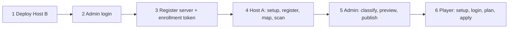

# ModSync usage runbook: which command, in which order

This is the hands-on companion to the [project guide](GUIDE.md). The guide explains *how it works*; this file tells you *what to type*.

Conventions:

- Commands are **bash** (Linux/macOS/WSL). Where PowerShell differs, a `PowerShell:` line follows.
- `modsync` means the client launcher `modsync-client/build/install/modsync-client/bin/modsync-client` (Windows: `bin\modsync-client.bat`). Same for `modsync-agent` → `modsync-agent/build/install/modsync-agent/bin/modsync-agent`. Put them on your `PATH` or alias them.
- Placeholders: `SERVER_UUID`, `AGENT_UUID`, `CONTROL_PLANE_UUID`, `https://modsync.example.org`.
- The control-plane UUID and server UUIDs are printed by the API; see each step.

## 0. What can I do?

| Role | Where | You can | Main tool |
|---|---|---|---|
| **Administrator** | Host B (+ any machine with the client) | Deploy the API/DB, create users, register Minecraft servers, enroll and assign agents, classify mods, preview and publish manifests, revoke agents/tokens, back up and restore | Docker Compose, `scripts/admin.py`, `modsync` (login only) |
| **Agent operator** | Host A (next to Crafty) | Scan a read-only `mods/` folder and upload the inventory on a schedule | `modsync-agent` |
| **Player** | Host C (your PC) | List servers, preview and apply a mod sync, verify, roll back, import personal mods, update-check | `modsync` |
| **Developer** | Anywhere with JDK 25 | Build, test, run the 3-host fixture | `./gradlew`, `python3 scripts/...` |

There is **no admin web UI**: administration is the HTTP API, driven by `scripts/admin.py`.



Order matters: nothing can be published until an agent has uploaded an inventory, and players see nothing until a manifest is published.

## 1. Prerequisites and build

Needs JDK 25, Python 3, and Docker (Docker is also used by the tests via Testcontainers).

```bash
./gradlew :modsync-server:bootJar :modsync-agent:installDist :modsync-client:installDist :modsync-client-tui:installDist
```
PowerShell: `.\gradlew.bat :modsync-server:bootJar :modsync-agent:installDist :modsync-client:installDist :modsync-client-tui:installDist`

Outputs: `modsync-agent/build/install/modsync-agent/`, `modsync-client/build/install/modsync-client/`, `modsync-client-tui/build/install/modsync-client-tui/`.
Native binaries (`:modsync-client:nativeCompile`, `:modsync-agent:nativeCompile`) need GraalVM 25 and are **not yet verified** (see `MEMORY.md`).

## 2. Host B: deploy the API and database

Work in `docker/server`. Full reference: [docker/server/README.md](../docker/server/README.md).

1. Create secrets (restrictive umask; files must be readable by UID 10001):
   ```bash
   cd docker/server
   umask 077
   mkdir -p ../../.local/secrets
   for n in db_password db_root_password bootstrap_password; do openssl rand -hex 32 > ../../.local/secrets/$n; done
   ```
2. Create the environment file and set `MODSYNC_SECRETS_DIR` to the **absolute** path of `.local/secrets`:
   ```bash
   cp .env.example .env
   ```
   Other variables: `MODSYNC_BIND_ADDRESS` (default `127.0.0.1`), `MODSYNC_MAINTENANCE`, `MODSYNC_SERVER_IMAGE`.
   PowerShell: `Copy-Item .env.example .env`.
3. Start:
   ```bash
   docker compose --env-file .env -f compose.yaml up -d --build
   docker compose --env-file .env -f compose.yaml ps
   ```
4. Put a TLS reverse proxy in front, forwarding to `127.0.0.1:8080`. Clients and agents require HTTPS ([networking](../NETWORKING.md)).
5. Verify:
   ```bash
   curl -fsS https://modsync.example.org/actuator/health
   curl -fsS https://modsync.example.org/api/v1/info
   ```
   `/api/v1/info` returns `controlPlaneId` — **write it down**; it is the `CONTROL_PLANE_UUID` every client and agent pins.
6. First start creates user `admin` only if no users exist. Its password is the content of `.local/secrets/bootstrap_password`.

### 2.1 Use an existing (external) MariaDB instead of the bundled one

The server needs **MariaDB 11.4.x**. Ask your DBA (or run as root) once; the deploy script only verifies, it never creates anything:

```sql
CREATE DATABASE modsync CHARACTER SET utf8mb4 COLLATE utf8mb4_unicode_ci;
CREATE USER 'modsync'@'%' IDENTIFIED BY '<password>';
GRANT ALL PRIVILEGES ON modsync.* TO 'modsync'@'%';
```
Flyway runs migrations at startup, so the user needs DDL rights on that schema.

```bash
scripts/deploy/01-server.zsh --db-host db.example.org --db-password-file ./modsync-db.pw --db-ssl-mode verify-full
```
```powershell
.\scripts\deploy\01-server.ps1 -DbHost db.example.org -DbPasswordFile .\modsync-db.pw -DbSslMode verify-full
```
Without a password file, an existing `secrets/db_password` or a silent prompt is used. The script tests login, version and a create/drop-table probe (skip with `--skip-db-check`), writes `.env`, and starts only `modsync-server`. `localhost` is mapped to `host.docker.internal`.

Manual equivalent (needs Docker Compose >= 2.24), with `MODSYNC_DB_URL`/`MODSYNC_DB_USER` set in `.env`:
```bash
docker compose --env-file .env -f compose.yaml -f compose.external-db.yaml up -d --build modsync-server
```
The `db_password` secret must contain the DB user's password. The bundled-DB backup scripts do not apply; use `mariadb-dump` on your DB host.

## 3. Administrator: log in and drive the API

### 3.1 Log in as admin (creates the config file `admin.py` uses)

```bash
modsync --state-dir ~/.modsync-admin setup --server-url https://modsync.example.org --trust-server-id CONTROL_PLANE_UUID
modsync --state-dir ~/.modsync-admin login --username admin --password-file /path/to/bootstrap_password
```
The config is `~/.modsync-admin/config.json`.
PowerShell: use `$HOME\.modsync-admin`.

### 3.2 `scripts/admin.py` pattern

```bash
python scripts/admin.py --config ~/.modsync-admin/config.json \
  --method POST --data request.json --out response.json [--secret-field token] [--ca-file ca.pem] admin/<route>
```

- Responses go to `--out`, never the terminal. `--secret-field token` writes only that field.
- It refuses non-HTTPS endpoints, absolute/`..` paths and a control-plane mismatch.
- Write the JSON request files first (PowerShell: any editor; the examples below are file contents).

### 3.3 Admin operations

| Goal | Method + route | Request body |
|---|---|---|
| Create a player | `POST admin/users` | `{"username":"alex","password":"<16–256 chars>"}` |
| Register a Minecraft server | `POST admin/servers` | `{"name":"survival","minecraftVersion":"1.21.1","loader":"neoforge","loaderVersion":"21.1.172"}` (`loader` defaults to `neoforge`; `loaderVersion` optional) |
| Create enrollment token | `POST admin/enrollments` | `{"ttlSeconds":600}` (60–3600). Use `--secret-field token`. |
| Revoke all open tokens | `POST admin/enrollments/revoke` | none |
| List agents | `GET admin/agents` | none |
| Assign agent to server | `PUT admin/servers/SERVER_UUID/assignment` | `{"agentId":"AGENT_UUID","mapping":"survival"}` (`mapping` = the alias used by `agent map`) |
| Revoke an agent | `POST admin/agents/AGENT_UUID/revoke` | none |
| Read uploaded inventory | `GET admin/servers/SERVER_UUID/inventory` | none |
| Identified mods | `GET admin/servers/SERVER_UUID/identified` | none |
| Classify a mod | `PUT admin/servers/SERVER_UUID/classification` | `{"sha512":"<hex>","classification":"CLIENT_REQUIRED","reason":"needed on client"}` |
| Preview a manifest | `POST admin/servers/SERVER_UUID/preview` | `{"scanId":"<scan>","artifacts":[…]}` |
| Publish | `POST admin/servers/SERVER_UUID/publish` | same as preview |

`classification` values: `SERVER_ONLY`, `CLIENT_REQUIRED`, `CLIENT_OPTIONAL`, `CLIENT_ONLY`, `BOTH_REQUIRED`, `UNKNOWN`.
An `artifacts[]` entry has `projectId, versionId, fileName, sha512, size, url?, minecraftVersions, loaders, classification, dependencies`. Details: [API.md](architecture/API.md).

Examples:

```bash
# Create a server, then print its id from the saved response
echo '{"name":"survival","minecraftVersion":"1.21.1","loader":"neoforge"}' > server.json
python scripts/admin.py --config ~/.modsync-admin/config.json --method POST --data server.json --out server-resp.json admin/servers

# Enrollment token written only to a file (give it to the agent operator)
echo '{"ttlSeconds":600}' > enroll.json
python scripts/admin.py --config ~/.modsync-admin/config.json --method POST --data enroll.json --out enrollment-token --secret-field token admin/enrollments
```

### 3.4 Publish workflow (after the agent has scanned)

1. `GET admin/servers/SERVER_UUID/inventory` → note `scanId` and every `sha512`.
2. `GET admin/servers/SERVER_UUID/identified` → see which hashes Modrinth recognised.
3. `PUT …/classification` for **every** scanned hash. Missing classifications block publishing.
4. `POST …/preview` with `scanId` and artifacts; fix reported problems.
5. `POST …/publish` with the same body. Artifacts are rebuilt from Modrinth by hash; manual artifacts have no URL and must match the scan.
6. If publish says the policy or snapshot changed, run preview again.

Rate limit: 20 requests/min/IP on login, refresh and enroll.

### 3.5 Create players

Create each with `admin/users`, then give them the server URL, `CONTROL_PLANE_UUID`, username and password through a safe channel.

## 4. Host A: agent (read-only mods folder)

Full reference: [docker/agent/README.md](../docker/agent/README.md). Run everything in `docker/agent`.

1. `cp .env.example .env` and set `MODSYNC_STATE_PATH` (writable state dir), `MINECRAFT_SERVERS_PATH` (Crafty servers root, mounted read-only at `/minecraft`), `MODSYNC_SCAN_INTERVAL` (seconds, default 300) and `MODSYNC_SERVER_URL`. The container runs as UID 10001.
2. Build and pin the server:
   ```bash
   docker compose --env-file .env build
   docker compose --env-file .env run --rm agent setup --server-url https://modsync.example.org --trust-server-id CONTROL_PLANE_UUID
   ```
3. Put the admin's enrollment token at `$MODSYNC_STATE_PATH/enrollment-token`, then register and delete it:
   ```bash
   docker compose --env-file .env run --rm agent register --enrollment-token-file /app/state/enrollment-token
   rm "$MODSYNC_STATE_PATH/enrollment-token"
   ```
4. Give the admin the new agent id (`admin/agents`) so they assign it (§3.3).
5. Map the alias to the server's `mods` folder and scan once:
   ```bash
   docker compose --env-file .env run --rm agent map survival /minecraft/SERVER_DIR/mods
   docker compose --env-file .env run --rm agent scan --server SERVER_UUID
   ```
6. Run continuously:
   ```bash
   docker compose --env-file .env up -d
   ```

Without Docker (JVM): `modsync-agent --state-dir DIR setup|register|map|scan|run [--interval 30..86400]|status|doctor`. Use `status` and `doctor` to troubleshoot. The agent only makes outbound HTTPS calls and never talks to players.

## 5. Player: Host C

### 5.0 Install the client (detailed)

The client is a JVM application (Kotlin, Picocli). There is no installer package yet; you build it from source. Every step below has a check so you know it worked.

**Step 1 — Install prerequisites**

| Tool | Version | Why | Check |
|---|---|---|---|
| JDK | 25 or newer | Runs and builds the client | `java -version` must report 25+ |
| Git | any | Get the source | `git --version` |

If `java -version` reports an older version, install JDK 25 (any vendor) and make sure it is first on `PATH`/`JAVA_HOME`.
PowerShell: `java -version; $env:JAVA_HOME`.

**Step 2 — Get the source**

```bash
git clone https://github.com/athegreat90/minecraft-modsync.git
cd minecraft-modsync
```

**Step 3 — Build the launcher**

```bash
./gradlew :modsync-client:installDist
```
PowerShell: `.\gradlew.bat :modsync-client:installDist`

The first run downloads Gradle and dependencies, so it needs internet access. The result is `modsync-client/build/install/modsync-client/`, containing `bin/modsync-client` (Linux/macOS) and `bin/modsync-client.bat` (Windows).

**Step 4 — Check that it runs**

```bash
modsync-client/build/install/modsync-client/bin/modsync-client --help
```
PowerShell: `.\modsync-client\build\install\modsync-client\bin\modsync-client.bat --help`

You should see the `modsync` command list (`setup`, `login`, `servers`, `instances`, `sync`, ...).

**Step 5 — Put it on your PATH (optional but recommended)**

zsh:
```zsh
echo 'export PATH="$PWD/modsync-client/build/install/modsync-client/bin:$PATH"' >> ~/.zshrc
exec zsh
modsync-client --help
```
PowerShell (persists for your user; open a new terminal afterwards):
```powershell
$bin = "$PWD\modsync-client\build\install\modsync-client\bin"
[Environment]::SetEnvironmentVariable('Path', "$([Environment]::GetEnvironmentVariable('Path','User'));$bin", 'User')
```
Below, `modsync` is shorthand for `modsync-client`.

**Step 6 — Get four values from your administrator**: the server URL, the `CONTROL_PLANE_UUID`, your username and your password (the password should arrive over a safe channel; save it to a file readable only by you, e.g. `~/alex.pw`).

**Step 7 — Optional: interactive TUI.** `modsync-client-tui` is built with `./gradlew :modsync-client-tui:installDist` and needs Java 25. Start it with `modsync interactive --tui-home DIR` (or set `MODSYNC_TUI_HOME`).

**Upgrade:** `git pull` then repeat Step 3. Your state in `~/.modsync` is kept.
**Uninstall:** delete the cloned folder, remove the PATH entry, and delete `~/.modsync` (this also removes your saved login and cached manifests; it does not touch your Minecraft folder).

Or run the automated version: `scripts/deploy/04-client.zsh` / `04-client.ps1` (see [section 11](#11-deploy-scripts-one-per-phase)).

### 5.1 First-time setup

```bash
modsync setup --server-url https://modsync.example.org --trust-server-id CONTROL_PLANE_UUID
modsync login --username alex --password-file ~/alex.pw
modsync connection test
modsync servers list
```
State lives in `~/.modsync` (override with `--state-dir`). On an interactive console `setup` prompts for the UUID if you omit it. If the UUID changes later, the client refuses to talk to the server (identity pinning).

### 5.2 Register your Minecraft instance

```bash
modsync instances discover
# or
modsync instances add survival "/path/to/instance" --minecraft-version 1.21.1 --loader neoforge [--loader-version 21.1.172]
modsync mods scan --instance survival
modsync mods list --instance survival
```
PowerShell path example: `"$env:APPDATA\.minecraft"` or your launcher's instance folder.

### 5.3 Sync

**Close Minecraft first.**

```bash
modsync sync plan --instance survival --server SERVER_UUID --out plan.json [--profile PROFILE_UUID] [--include-optional] [--approve-removal FILE ...]
modsync sync apply --instance survival --plan plan.json --dry-run     # preview only
modsync sync apply --instance survival --plan plan.json
modsync sync verify --instance survival
```

Plan operations: `INSTALL`, `UPDATE`, `KEEP`, `DISABLE`, `REMOVE_MANAGED`, `QUARANTINE_DUPLICATE`, `SKIP` (unmanaged files are never touched), `CONFLICT`, `MANUAL_ACTION_REQUIRED`.
A plan containing `CONFLICT` or `MANUAL_ACTION_REQUIRED` is blocked; fix it before applying. `apply` re-checks that the published manifest has not changed.

#### Duplicate mod versions

ModSync identifies mods by the mod id declared in their metadata, not by file name, so two jars of the same mod are found even when their file names differ. The plan names the version it keeps and the older file for every duplicate:

| Situation | Plan result | What you do |
|---|---|---|
| Older version installed by ModSync | `REMOVE_MANAGED` (needs a policy that allows removals in automatic mode) | Nothing; `apply` removes it with a backup |
| Older version you installed yourself | `MANUAL_ACTION_REQUIRED` ("removing it needs your approval") | Re-run `sync plan ... --approve-removal FILE`; the file becomes `QUARANTINE_DUPLICATE` and is moved to a recoverable backup under `.modsync/<session>/backup` (`sync rollback` restores it) |
| Installed version is newer than the exact version the server pins | `CONFLICT`; ModSync never downgrades or installs a second copy | Ask the server administrator to publish that version or newer, or remove your file yourself |
| Version order, version or Minecraft/NeoForge compatibility cannot be established (missing version, unknown format, multi-mod jar) | `CONFLICT` | Decide manually which file to keep and remove the other |

Automatic synchronization (`auto run`) never removes files you installed yourself and never reports `UpToDate` while two files provide the same mod. `sync verify` fails and lists duplicates (`DUPLICATE mod <id> is provided by ...`). Manifests published before 0.4.1 carry no mod identity: ModSync still refuses to install a downloaded jar that would duplicate an installed mod id, and the server administrator should publish a new revision to restore full duplicate planning.

### 5.3a Automatic synchronization (opt-in, per instance)

Automatic mode needs explicit consent for each instance and never runs while Minecraft is using it.

```
modsync auto enable --instance main --server <server-uuid> --policy AUTO_APPROVED_INSTALL --yes
modsync auto status
modsync auto run --once          # one pass; use from a scheduler, exits non-zero on failure
modsync auto run                 # foreground loop: 15 min interval, jitter and exponential backoff
modsync auto disable --instance main
modsync auto schedule --platform systemd --executable /opt/modsync/bin/modsync   # or --platform windows
```

Policies: `AUTO_APPROVED_INSTALL` (new required mods only), `AUTO_APPROVED_UPDATE` (+ version updates), `AUTO_ALL_MANAGED` (+ removal of mods the server previously required). Conflicts, unknown classifications, unmanaged files and personal-profile mods are never changed automatically; such plans stay pending and are reported as `SYNC_PENDING`. If the game runs, the pass is deferred (`PENDING_GAME_EXIT`). The client checks the published revision first and skips scanning/downloading when it is unchanged and was verified within 24 hours. After each pass it uploads an inventory (file names and hashes, no paths) to `POST /api/v1/client/inventory`.

Game detection looks for a Java process whose command line contains the instance directory; launchers that do not pass it cannot be detected, so close the game before scheduled runs when in doubt.

### 5.4 Roll back and offline use

```bash
modsync sync rollback --instance survival      # latest transaction only
modsync sync cached --server SERVER_UUID       # inspect cached manifest
```
If an installation was interrupted, run `rollback` before applying again.

### 5.5 Personal mods and other helpers

```bash
modsync personal import profile.json   # Modrinth projects the server doesn't provide ("unsupported" server side)
modsync personal list
modsync config show
modsync config set server-url https://new.example.org
modsync doctor
modsync interactive --tui-home DIR   # JLine TUI from modsync-client-tui (or env MODSYNC_TUI_HOME); needs Java 25
```

## 6. End-to-end example

| # | Who | Command |
|---|---|---|
| 1 | Admin | §2 deploy, write down `CONTROL_PLANE_UUID` |
| 2 | Admin | §3.1 login; `POST admin/servers` → `SERVER_UUID` |
| 3 | Admin | `POST admin/enrollments --secret-field token` → give token file to operator |
| 4 | Operator | §4 steps 2–3, report `AGENT_UUID` |
| 5 | Admin | `PUT admin/servers/SERVER_UUID/assignment` |
| 6 | Operator | §4 step 5 (`map`, `scan`) |
| 7 | Admin | §3.4 inventory → classify all → preview → publish |
| 8 | Admin | `POST admin/users` for each player |
| 9 | Player | §5.1–5.3 |

## 7. Backup, restore, maintenance

```bash
scripts/backup/export.sh docker/server/compose.yaml backup.sql        # refuses to overwrite; writes backup.sql.sha256
MODSYNC_RESTORE_CONFIRMED=fresh-database scripts/backup/import.sh docker/server/compose.yaml backup.sql
```
These scripts target the bundled `mariadb` service; with an external MariaDB ([2.1](#21-use-an-existing-external-mariadb-instead-of-the-bundled-one)) back up with `mariadb-dump`. Restore only into an isolated, fresh database. Set `MODSYNC_MAINTENANCE` in `.env` and recreate the container for maintenance mode. See [HOST_MIGRATION.md](../HOST_MIGRATION.md) and [DATABASE.md](../DATABASE.md).

## 8. Developer commands

```bash
./gradlew check :modsync-server:bootJar :modsync-agent:installDist :modsync-client:installDist :modsync-client-tui:installDist
python3 scripts/check-architecture.py
python3 scripts/openapi.py --check
python3 -m unittest discover -s scripts/release -p 'test_*.py'
python3 -m unittest discover -s scripts/repository -p 'test_*.py'
python3 -m unittest discover -s scripts/backup -p 'test_*.py'
python3 scripts/integration/distributed.py     # 3-host TLS fixture (needs Docker)
```
On Windows use `.\gradlew.bat` and `python` instead of `python3`.

## 9. Troubleshooting

| Symptom | Cause | Fix |
|---|---|---|
| "Control-plane identity changed/mismatch" | Wrong `--trust-server-id`, or the DB was recreated | Verify `GET /api/v1/info`; re-run `setup` only if you trust the change |
| HTTP 426 | Client/agent protocol or version header unsupported | Update to a matching release |
| HTTP 429 | Over 20 requests/min on login/refresh/enroll | Wait a minute |
| Enrollment fails | Token expired (60–3600 s TTL) or already used | Create a new one |
| `servers list` is empty/no revision | Nothing published yet | §3.4 |
| Plan is blocked | `CONFLICT` or `MANUAL_ACTION_REQUIRED` | Read the plan, resolve the file or dependency, re-plan |
| Plan says "removing it needs your approval" | An older duplicate that ModSync did not install | Re-plan with `--approve-removal FILE`, or remove the file yourself |
| "Published manifest changed" | A newer revision was published after `plan` | Run `sync plan` again |
| Publish rejected, "preview again" | Policy or snapshot changed | Re-run preview |
| Interrupted installation | Crash or game running during apply | `sync rollback`, then retry with Minecraft closed |
| Inventory stale | Agent stopped or token revoked | `agent status`/`doctor`, check container, re-enroll |
| Agent can't read mods | UID 10001 lacks access or wrong mount | Fix permissions; mount `MINECRAFT_SERVERS_PATH` |

## 10. Cheat sheet

| Variable | Used by | Meaning |
|---|---|---|
| `MODSYNC_SECRETS_DIR` | server compose | Absolute path to secrets |
| `MODSYNC_BIND_ADDRESS` | server compose | Listen address (default `127.0.0.1`) |
| `MODSYNC_MAINTENANCE` | server compose | Maintenance mode |
| `MODSYNC_SERVER_IMAGE` | server compose | Image override |
| `MODSYNC_STATE_PATH` / `MODSYNC_STATE_DIR` | agent | State directory |
| `MINECRAFT_SERVERS_PATH` | agent compose | Read-only mount of Crafty servers |
| `MODSYNC_SERVER_URL` | agent | API URL |
| `MODSYNC_SCAN_INTERVAL` | agent | Seconds between scans (default 300) |

Token lifetimes: access 1 h, refresh 30 d, agent credential 30 d.

## 11. Deploy scripts (one per phase)

`scripts/deploy/` automates each phase with the same options in **zsh** (`.zsh`) and **PowerShell** (`.ps1`); see [scripts/deploy/README.md](../scripts/deploy/README.md) for per-phase options and ready-made prompts for Claude Code, Codex and Antigravity. Each script is fail-fast, prints no secrets, supports `--help` (`Get-Help .\script.ps1` in PowerShell), and runs on the host where that phase belongs.

| Phase | Host | zsh | PowerShell | What it does |
|---|---|---|---|---|
| 1 | B | `01-server.zsh` | `01-server.ps1` | Generate secrets, write `modsync-deploy/server/.env`, pull the GHCR image, `docker compose up -d`, wait for health, print `/api/v1/info` |
| 2 | Admin machine | `02-admin.zsh` | `02-admin.ps1` | Download the client + `admin.py` from the GitHub Release, pin the server, log in as `admin`, register a Minecraft server, write an enrollment token file |
| 3 | A | `03-agent.zsh` | `03-agent.ps1` | Write `modsync-deploy/agent/.env`, pull the GHCR image, pin, register (token deleted afterwards), map, optional first scan, start |
| 4 | C (player) | `04-client.zsh` | `04-client.ps1` | Download the native client from the Release (checksum-verified), optional PATH entry, pin, login, connection test, add or discover an instance |

### 11.1 Run without the repository (GHCR images and Release downloads)

The scripts never build anything. They use the images published to GHCR (`ghcr.io/athegreat90/minecraft-modsync-server` and `-agent`) and the native client from the GitHub Release, so you only need the script you want to run (plus Docker for phases 1 and 3, and Python 3 for phase 2):

```bash
curl -fsSLO https://raw.githubusercontent.com/athegreat90/minecraft-modsync/main/scripts/deploy/01-server.zsh
chmod +x 01-server.zsh && ./01-server.zsh --url http://127.0.0.1:8080
```
```powershell
Invoke-WebRequest https://raw.githubusercontent.com/athegreat90/minecraft-modsync/main/scripts/deploy/01-server.ps1 -OutFile 01-server.ps1
.\01-server.ps1 -Url http://127.0.0.1:8080
```

Shared options on every phase:

| zsh | PowerShell | Meaning |
|---|---|---|
| `--version TAG` | `-Version TAG` | Release tag for the images and client. Default: the newest GitHub release (pre-releases included if there is no stable one) |
| `--repo OWNER/REPO` | `-Repo OWNER/REPO` | Publisher of the images/release (default `athegreat90/minecraft-modsync`; use it for a fork) |
| `--work-dir DIR` | `-WorkDir DIR` | Where compose files, `.env`, secrets and the downloaded client live (default `./modsync-deploy`) |

What gets created under the work dir: `server/compose.yml` (+ `compose.external-db.yml`), `server/.env`, `secrets/` (phase 1), `agent/compose.yml` and `agent/.env` (phase 3), `bin/modsync` (phases 2 and 4). A compose file next to the script (`scripts/deploy/server/compose.yml`, `agent/compose.yml`) is used when present; otherwise it is downloaded from the release tag, falling back to `main` if the tag predates it. Phases 2 and 4 download `modsync-<platform>` and verify it against the release's `SHA256SUMS`; native builds exist for linux-x64, linux-arm64 and windows-x64 (other platforms use the Java client zip and need Java 25+). If the GHCR packages are private, run `docker login ghcr.io` first.

The phase 2 password file is now `modsync-deploy/secrets/bootstrap_password` (adjust the examples below if you used another `--work-dir` or `--secrets-dir`).

```zsh
# Phase 1, on Host B
scripts/deploy/01-server.zsh --url http://127.0.0.1:8080

# Phase 2, admin machine (needs the controlPlaneId printed by phase 1)
scripts/deploy/02-admin.zsh --server-url https://modsync.example.org --control-plane-id CONTROL_PLANE_UUID \
  --password-file modsync-deploy/secrets/bootstrap_password --name survival --minecraft-version 1.21.1

# Phase 3, on Host A (token file from phase 2)
scripts/deploy/03-agent.zsh --server-url https://modsync.example.org --control-plane-id CONTROL_PLANE_UUID \
  --token-file ./enrollment-token --state-path /srv/modsync/agent --servers-path /srv/crafty/servers \
  --alias survival --mods-dir survival/mods

# Phase 4, on the player's machine
scripts/deploy/04-client.zsh --server-url https://modsync.example.org --control-plane-id CONTROL_PLANE_UUID \
  --username alex --password-file ~/alex.pw --instance-name survival --instance-path ~/mc/survival \
  --minecraft-version 1.21.1 --loader neoforge --add-to-path
```

```powershell
.\scripts\deploy\01-server.ps1 -Url http://127.0.0.1:8080
.\scripts\deploy\02-admin.ps1 -ServerUrl https://modsync.example.org -ControlPlaneId CONTROL_PLANE_UUID `
  -PasswordFile .\modsync-deploy\secrets\bootstrap_password -Name survival -MinecraftVersion 1.21.1
.\scripts\deploy\03-agent.ps1 -ServerUrl https://modsync.example.org -ControlPlaneId CONTROL_PLANE_UUID `
  -TokenFile .\enrollment-token -StatePath D:\modsync\agent -ServersPath D:\crafty\servers -Alias survival -ModsDir survival/mods
.\scripts\deploy\04-client.ps1 -ServerUrl https://modsync.example.org -ControlPlaneId CONTROL_PLANE_UUID `
  -Username alex -PasswordFile $HOME\alex.pw -InstanceName survival -InstancePath "$env:APPDATA\.minecraft" `
  -MinecraftVersion 1.21.1 -Loader neoforge -AddToPath
```
If PowerShell blocks scripts: `Set-ExecutionPolicy -Scope Process Bypass`.

Notes:

- Between phases 3 and 4 the administrator still has to **assign the agent, classify, preview and publish** ([section 3](#3-administrator-log-in-and-drive-the-api)); those steps depend on human decisions, so they are not scripted. Phase 2 prints `SERVER_UUID`; the agent id comes from `GET admin/agents`.
- Phase 1 supports an existing MariaDB via `--db-host` / `-DbHost` (also `--db-port`, `--db-name`, `--db-user`, `--db-password-file`, `--db-ssl-mode`, `--db-url`, `--skip-db-check`); see [2.1](#21-use-an-existing-external-mariadb-instead-of-the-bundled-one).
- Phase 1 does not set up TLS; put a reverse proxy in front before phases 2-4, which require HTTPS.
- On Linux the server container reads secrets as UID 10001: run phase 1 as root or `chown -R 10001:10001` the secrets directory. On Windows/Docker Desktop, check file sharing if the container cannot read them.
- `MODSYNC_CLIENT` overrides the client launcher used by phase 2.
- The scripts were syntax-checked (zsh `-n`, PowerShell parser) and their `--help`/argument validation exercised, but a live end-to-end deployment has not been run.

## Administration dashboard

Host B serves a server-rendered dashboard at `https://<host-b>/ui` (sign in with an `ADMIN` account such as the bootstrap admin). It shows servers, inventory freshness, scanned mods and their approval state, the latest manifest, the client coverage matrix and publication history. Administrators can change a server's publication policy, approve a mod's classification with a reason, and request re-evaluation of automatic publication. Manifest preview and publish remain API operations. The dashboard runs no commands and needs no JavaScript.

### Managing users

Open **Users** in the dashboard header (`/ui/users`).

- **Find accounts:** search by username fragment and filter by role or status. The list shows 25 accounts per page.
- **Create a user:** choose **Create user**, enter a username (letters, digits, `_`, `.`, `-`, up to 100 characters) and a password of 16 to 256 characters twice. New accounts always get the `CLIENT` role. Pass the password to the player through a secure channel.
- **Disable or enable:** a disabled account cannot sign in, refresh or use any token, and its sessions end at once. Its devices stay registered, so enabling it again lets its clients sign in with the same device.
- **Reset a password:** enter the new password twice. Existing sessions and tokens of the account end, so its clients sign in again.
- **Revoke sessions:** ends tokens and sessions only; devices stay valid.
- **Revoke devices:** permanent. A revoked device id can never sign in again, so each client must register with a new one. Tick the confirmation box to proceed.
- **Administrator accounts** are listed but read-only here, and the page rejects changes to them. During maintenance mode the pages stay readable and every change is refused with an error.
- Session cookies are marked `Secure`. For a test deployment without HTTPS set `MODSYNC_SESSION_COOKIE_SECURE=false`, otherwise browsers will not send the cookie and sign-in appears to fail.

