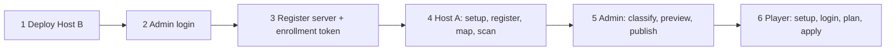

# ModSync usage runbook: which command, in which order

This is the hands-on companion to the [project guide](GUIDE.md). The guide explains *how it works*; this file tells you *what to type*.

Conventions:

- Commands are **bash** (Linux/macOS/WSL). Where PowerShell differs, a `PowerShell:` line follows.
- `modsync` means the client launcher `modsync-client/build/install/modsync-client/bin/modsync-client` (Windows: `bin\modsync-client.bat`). Same for `modsync-agent` → `modsync-agent/build/install/modsync-agent/bin/modsync-agent`. Put them on your `PATH` or alias them.
- Placeholders: `SERVER_UUID`, `AGENT_UUID`, `CONTROL_PLANE_UUID`, `https://modsync.example.org`.
- The control-plane UUID and server UUIDs are printed by the API; see each step.

## 0. What can I do?

| Role | Where | You can | Main tool |
|---|---|---|---|
| **Administrator** | Host B (+ any machine with the client) | Deploy the API/DB, create users, register Minecraft servers, enroll and assign agents, classify mods, preview and publish manifests, revoke agents/tokens, back up and restore | Docker Compose, `scripts/admin.py`, `modsync` (login only) |
| **Agent operator** | Host A (next to Crafty) | Scan a read-only `mods/` folder and upload the inventory on a schedule | `modsync-agent` |
| **Player** | Host C (your PC) | List servers, preview and apply a mod sync, verify, roll back, import personal mods, update-check | `modsync` |
| **Developer** | Anywhere with JDK 25 | Build, test, run the 3-host fixture | `./gradlew`, `python3 scripts/...` |

There is **no admin web UI**: administration is the HTTP API, driven by `scripts/admin.py`.



Order matters: nothing can be published until an agent has uploaded an inventory, and players see nothing until a manifest is published.

## 1. Prerequisites and build

Needs JDK 25, Python 3, and Docker (Docker is also used by the tests via Testcontainers).

```bash
./gradlew :modsync-server:bootJar :modsync-agent:installDist :modsync-client:installDist :modsync-client-tui:installDist
```
PowerShell: `.\gradlew.bat :modsync-server:bootJar :modsync-agent:installDist :modsync-client:installDist :modsync-client-tui:installDist`

Outputs: `modsync-agent/build/install/modsync-agent/`, `modsync-client/build/install/modsync-client/`, `modsync-client-tui/build/install/modsync-client-tui/`.
Native binaries (`:modsync-client:nativeCompile`, `:modsync-agent:nativeCompile`) need GraalVM 25 and are **not yet verified** (see `MEMORY.md`).

## 2. Host B: deploy the API and database

Work in `docker/server`. Full reference: [docker/server/README.md](../docker/server/README.md).

1. Create secrets (restrictive umask; files must be readable by UID 10001):
   ```bash
   cd docker/server
   umask 077
   mkdir -p ../../.local/secrets
   for n in db_password db_root_password bootstrap_password; do openssl rand -hex 32 > ../../.local/secrets/$n; done
   ```
2. Create the environment file and set `MODSYNC_SECRETS_DIR` to the **absolute** path of `.local/secrets`:
   ```bash
   cp .env.example .env
   ```
   Other variables: `MODSYNC_BIND_ADDRESS` (default `127.0.0.1`), `MODSYNC_MAINTENANCE`, `MODSYNC_SERVER_IMAGE`.
   PowerShell: `Copy-Item .env.example .env`.
3. Start:
   ```bash
   docker compose --env-file .env -f compose.yaml up -d --build
   docker compose --env-file .env -f compose.yaml ps
   ```
4. Put a TLS reverse proxy in front, forwarding to `127.0.0.1:8080`. Clients and agents require HTTPS ([networking](../NETWORKING.md)).
5. Verify:
   ```bash
   curl -fsS https://modsync.example.org/actuator/health
   curl -fsS https://modsync.example.org/api/v1/info
   ```
   `/api/v1/info` returns `controlPlaneId` — **write it down**; it is the `CONTROL_PLANE_UUID` every client and agent pins.
6. First start creates user `admin` only if no users exist. Its password is the content of `.local/secrets/bootstrap_password`.

## 3. Administrator: log in and drive the API

### 3.1 Log in as admin (creates the config file `admin.py` uses)

```bash
modsync --state-dir ~/.modsync-admin setup --server-url https://modsync.example.org --trust-server-id CONTROL_PLANE_UUID
modsync --state-dir ~/.modsync-admin login --username admin --password-file /path/to/bootstrap_password
```
The config is `~/.modsync-admin/config.json`.
PowerShell: use `$HOME\.modsync-admin`.

### 3.2 `scripts/admin.py` pattern

```bash
python scripts/admin.py --config ~/.modsync-admin/config.json \
  --method POST --data request.json --out response.json [--secret-field token] [--ca-file ca.pem] admin/<route>
```

- Responses go to `--out`, never the terminal. `--secret-field token` writes only that field.
- It refuses non-HTTPS endpoints, absolute/`..` paths and a control-plane mismatch.
- Write the JSON request files first (PowerShell: any editor; the examples below are file contents).

### 3.3 Admin operations

| Goal | Method + route | Request body |
|---|---|---|
| Create a player | `POST admin/users` | `{"username":"alex","password":"<16–256 chars>"}` |
| Register a Minecraft server | `POST admin/servers` | `{"name":"survival","minecraftVersion":"1.21.1","loader":"neoforge","loaderVersion":"21.1.172"}` (`loader` defaults to `neoforge`; `loaderVersion` optional) |
| Create enrollment token | `POST admin/enrollments` | `{"ttlSeconds":600}` (60–3600). Use `--secret-field token`. |
| Revoke all open tokens | `POST admin/enrollments/revoke` | none |
| List agents | `GET admin/agents` | none |
| Assign agent to server | `PUT admin/servers/SERVER_UUID/assignment` | `{"agentId":"AGENT_UUID","mapping":"survival"}` (`mapping` = the alias used by `agent map`) |
| Revoke an agent | `POST admin/agents/AGENT_UUID/revoke` | none |
| Read uploaded inventory | `GET admin/servers/SERVER_UUID/inventory` | none |
| Identified mods | `GET admin/servers/SERVER_UUID/identified` | none |
| Classify a mod | `PUT admin/servers/SERVER_UUID/classification` | `{"sha512":"<hex>","classification":"CLIENT_REQUIRED","reason":"needed on client"}` |
| Preview a manifest | `POST admin/servers/SERVER_UUID/preview` | `{"scanId":"<scan>","artifacts":[…]}` |
| Publish | `POST admin/servers/SERVER_UUID/publish` | same as preview |

`classification` values: `SERVER_ONLY`, `CLIENT_REQUIRED`, `CLIENT_OPTIONAL`, `CLIENT_ONLY`, `BOTH_REQUIRED`, `UNKNOWN`.
An `artifacts[]` entry has `projectId, versionId, fileName, sha512, size, url?, minecraftVersions, loaders, classification, dependencies`. Details: [API.md](architecture/API.md).

Examples:

```bash
# Create a server, then print its id from the saved response
echo '{"name":"survival","minecraftVersion":"1.21.1","loader":"neoforge"}' > server.json
python scripts/admin.py --config ~/.modsync-admin/config.json --method POST --data server.json --out server-resp.json admin/servers

# Enrollment token written only to a file (give it to the agent operator)
echo '{"ttlSeconds":600}' > enroll.json
python scripts/admin.py --config ~/.modsync-admin/config.json --method POST --data enroll.json --out enrollment-token --secret-field token admin/enrollments
```

### 3.4 Publish workflow (after the agent has scanned)

1. `GET admin/servers/SERVER_UUID/inventory` → note `scanId` and every `sha512`.
2. `GET admin/servers/SERVER_UUID/identified` → see which hashes Modrinth recognised.
3. `PUT …/classification` for **every** scanned hash. Missing classifications block publishing.
4. `POST …/preview` with `scanId` and artifacts; fix reported problems.
5. `POST …/publish` with the same body. Artifacts are rebuilt from Modrinth by hash; manual artifacts have no URL and must match the scan.
6. If publish says the policy or snapshot changed, run preview again.

Rate limit: 20 requests/min/IP on login, refresh and enroll.

### 3.5 Create players

Create each with `admin/users`, then give them the server URL, `CONTROL_PLANE_UUID`, username and password through a safe channel.

## 4. Host A: agent (read-only mods folder)

Full reference: [docker/agent/README.md](../docker/agent/README.md). Run everything in `docker/agent`.

1. `cp .env.example .env` and set `MODSYNC_STATE_PATH` (writable state dir), `MINECRAFT_SERVERS_PATH` (Crafty servers root, mounted read-only at `/minecraft`), `MODSYNC_SCAN_INTERVAL` (seconds, default 300) and `MODSYNC_SERVER_URL`. The container runs as UID 10001.
2. Build and pin the server:
   ```bash
   docker compose --env-file .env build
   docker compose --env-file .env run --rm agent setup --server-url https://modsync.example.org --trust-server-id CONTROL_PLANE_UUID
   ```
3. Put the admin's enrollment token at `$MODSYNC_STATE_PATH/enrollment-token`, then register and delete it:
   ```bash
   docker compose --env-file .env run --rm agent register --enrollment-token-file /app/state/enrollment-token
   rm "$MODSYNC_STATE_PATH/enrollment-token"
   ```
4. Give the admin the new agent id (`admin/agents`) so they assign it (§3.3).
5. Map the alias to the server's `mods` folder and scan once:
   ```bash
   docker compose --env-file .env run --rm agent map survival /minecraft/SERVER_DIR/mods
   docker compose --env-file .env run --rm agent scan --server SERVER_UUID
   ```
6. Run continuously:
   ```bash
   docker compose --env-file .env up -d
   ```

Without Docker (JVM): `modsync-agent --state-dir DIR setup|register|map|scan|run [--interval 30..86400]|status|doctor`. Use `status` and `doctor` to troubleshoot. The agent only makes outbound HTTPS calls and never talks to players.

## 5. Player: Host C

### 5.1 First-time setup

```bash
modsync setup --server-url https://modsync.example.org --trust-server-id CONTROL_PLANE_UUID
modsync login --username alex --password-file ~/alex.pw
modsync connection test
modsync servers list
```
State lives in `~/.modsync` (override with `--state-dir`). On an interactive console `setup` prompts for the UUID if you omit it. If the UUID changes later, the client refuses to talk to the server (identity pinning).

### 5.2 Register your Minecraft instance

```bash
modsync instances discover
# or
modsync instances add survival "/path/to/instance" --minecraft-version 1.21.1 --loader neoforge [--loader-version 21.1.172]
modsync mods scan --instance survival
modsync mods list --instance survival
```
PowerShell path example: `"$env:APPDATA\.minecraft"` or your launcher's instance folder.

### 5.3 Sync

**Close Minecraft first.**

```bash
modsync sync plan --instance survival --server SERVER_UUID --out plan.json [--profile PROFILE_UUID] [--include-optional]
modsync sync apply --instance survival --plan plan.json --dry-run     # preview only
modsync sync apply --instance survival --plan plan.json
modsync sync verify --instance survival
```

Plan operations: `INSTALL`, `UPDATE`, `KEEP`, `DISABLE`, `REMOVE_MANAGED`, `SKIP` (unmanaged files are never touched), `CONFLICT`, `MANUAL_ACTION_REQUIRED`.
A plan containing `CONFLICT` or `MANUAL_ACTION_REQUIRED` is blocked; fix it before applying. `apply` re-checks that the published manifest has not changed.

### 5.4 Roll back and offline use

```bash
modsync sync rollback --instance survival      # latest transaction only
modsync sync cached --server SERVER_UUID       # inspect cached manifest
```
If an installation was interrupted, run `rollback` before applying again.

### 5.5 Personal mods and other helpers

```bash
modsync personal import profile.json   # Modrinth projects the server doesn't provide ("unsupported" server side)
modsync personal list
modsync config show
modsync config set server-url https://new.example.org
modsync doctor
modsync interactive --tui-home DIR   # JLine TUI from modsync-client-tui (or env MODSYNC_TUI_HOME); needs Java 25
```

## 6. End-to-end example

| # | Who | Command |
|---|---|---|
| 1 | Admin | §2 deploy, write down `CONTROL_PLANE_UUID` |
| 2 | Admin | §3.1 login; `POST admin/servers` → `SERVER_UUID` |
| 3 | Admin | `POST admin/enrollments --secret-field token` → give token file to operator |
| 4 | Operator | §4 steps 2–3, report `AGENT_UUID` |
| 5 | Admin | `PUT admin/servers/SERVER_UUID/assignment` |
| 6 | Operator | §4 step 5 (`map`, `scan`) |
| 7 | Admin | §3.4 inventory → classify all → preview → publish |
| 8 | Admin | `POST admin/users` for each player |
| 9 | Player | §5.1–5.3 |

## 7. Backup, restore, maintenance

```bash
scripts/backup/export.sh docker/server/compose.yaml backup.sql        # refuses to overwrite; writes backup.sql.sha256
MODSYNC_RESTORE_CONFIRMED=fresh-database scripts/backup/import.sh docker/server/compose.yaml backup.sql
```
Restore only into an isolated, fresh database. Set `MODSYNC_MAINTENANCE` in `.env` and recreate the container for maintenance mode. See [HOST_MIGRATION.md](../HOST_MIGRATION.md) and [DATABASE.md](../DATABASE.md).

## 8. Developer commands

```bash
./gradlew check :modsync-server:bootJar :modsync-agent:installDist :modsync-client:installDist :modsync-client-tui:installDist
python3 scripts/check-architecture.py
python3 scripts/openapi.py --check
python3 -m unittest discover -s scripts/release -p 'test_*.py'
python3 -m unittest discover -s scripts/repository -p 'test_*.py'
python3 -m unittest discover -s scripts/backup -p 'test_*.py'
python3 scripts/integration/distributed.py     # 3-host TLS fixture (needs Docker)
```
On Windows use `.\gradlew.bat` and `python` instead of `python3`.

## 9. Troubleshooting

| Symptom | Cause | Fix |
|---|---|---|
| "Control-plane identity changed/mismatch" | Wrong `--trust-server-id`, or the DB was recreated | Verify `GET /api/v1/info`; re-run `setup` only if you trust the change |
| HTTP 426 | Client/agent protocol or version header unsupported | Update to a matching release |
| HTTP 429 | Over 20 requests/min on login/refresh/enroll | Wait a minute |
| Enrollment fails | Token expired (60–3600 s TTL) or already used | Create a new one |
| `servers list` is empty/no revision | Nothing published yet | §3.4 |
| Plan is blocked | `CONFLICT` or `MANUAL_ACTION_REQUIRED` | Read the plan, resolve the file or dependency, re-plan |
| "Published manifest changed" | A newer revision was published after `plan` | Run `sync plan` again |
| Publish rejected, "preview again" | Policy or snapshot changed | Re-run preview |
| Interrupted installation | Crash or game running during apply | `sync rollback`, then retry with Minecraft closed |
| Inventory stale | Agent stopped or token revoked | `agent status`/`doctor`, check container, re-enroll |
| Agent can't read mods | UID 10001 lacks access or wrong mount | Fix permissions; mount `MINECRAFT_SERVERS_PATH` |

## 10. Cheat sheet

| Variable | Used by | Meaning |
|---|---|---|
| `MODSYNC_SECRETS_DIR` | server compose | Absolute path to secrets |
| `MODSYNC_BIND_ADDRESS` | server compose | Listen address (default `127.0.0.1`) |
| `MODSYNC_MAINTENANCE` | server compose | Maintenance mode |
| `MODSYNC_SERVER_IMAGE` | server compose | Image override |
| `MODSYNC_STATE_PATH` / `MODSYNC_STATE_DIR` | agent | State directory |
| `MINECRAFT_SERVERS_PATH` | agent compose | Read-only mount of Crafty servers |
| `MODSYNC_SERVER_URL` | agent | API URL |
| `MODSYNC_SCAN_INTERVAL` | agent | Seconds between scans (default 300) |

Token lifetimes: access 1 h, refresh 30 d, agent credential 30 d.
