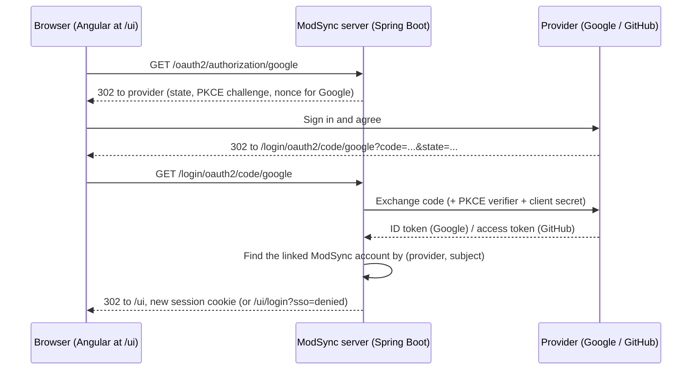

# Google and GitHub sign-in (SSO) setup guide

This guide shows, step by step, how to let administrators sign in to the ModSync administration interface with a Google or a GitHub account. You do not need to know OAuth2 or OpenID Connect beforehand, and you do not need to read the source code.

> **Status of this guide.** Provider menus were checked against Google's and GitHub's official documentation on 2026-11-14 (links are given in each step). Cloud consoles change; if a label differs from this guide, trust the console and the linked page. Steps that only a human can do (creating the provider credentials, signing in) are marked **Human action**. Nothing in this guide has been verified against *your* Google or GitHub account, and no real credentials are used anywhere in the repository.

**Contents:** [1. Introduction](#1-introduction) · [2. Prerequisites](#2-prerequisites) · [3. Google](#3-google-sso) · [4. GitHub](#4-github-sso) · [5. Spring Boot configuration](#5-how-the-server-is-configured) · [6. Secrets](#6-environment-variables-and-secrets) · [7. Docker Compose](#7-docker-compose) · [8. Reverse proxy and HTTPS](#8-reverse-proxy-and-https) · [9. Linking and permissions](#9-account-linking-and-permissions) · [10. Local development](#10-local-development) · [11. Production](#11-production-deployment) · [12. Troubleshooting](#12-troubleshooting) · [13. Rotation and recovery](#13-credential-rotation-and-incident-recovery) · [14. Security checklist](#14-security-checklist) · [15. Final checklist](#15-final-verification-checklist)

---

## 1. Introduction

**Single sign-on (SSO)** means you prove who you are to a company you already use (Google or GitHub) and ModSync trusts that proof, so you do not type a ModSync password.

**OAuth2** is the protocol that lets one site (ModSync) ask another (Google) to confirm a person after that person agrees. **OpenID Connect (OIDC)** is a layer on top of OAuth2 that standardises *who the person is*: Google returns a signed *ID token*. **GitHub** supports OAuth2 only. It does not return an ID token; ModSync asks GitHub for the user's profile with the access token instead. That is why the two providers behave slightly differently inside the server, but look the same to you.

| Term | Meaning |
|---|---|
| **Client ID** | A public name for ModSync at the provider. Not secret. |
| **Client secret** | A password that proves a request really comes from the ModSync server. **Secret.** |
| **Redirect (callback) URI** | The exact address the provider sends the browser back to after you agree. ModSync's is `https://<YOUR_DOMAIN>/login/oauth2/code/google` (or `.../github`). |
| **Scope** | What ModSync asks to see. ModSync asks for the minimum: Google `openid profile email`, GitHub `read:user`. |
| **Subject ID** | The provider's permanent number for a person (Google `sub`, GitHub numeric `id`). ModSync links accounts using this, **never the email address**, because email addresses can change or be reused. |

**Who does what.** The Spring Boot server performs the whole sign-in and keeps the secrets. The Angular page only shows a button that opens `/oauth2/authorization/google` (or `github`); it never sees a client secret, a provider token or a password.

**Existing accounts.** SSO does not create accounts and does not grant rights. A Google/GitHub account can sign in only after an administrator has **linked** it to an existing ModSync administrator account. A valid Google or GitHub login for someone who is not linked is refused. Local username/password sign-in keeps working and Minecraft clients and scanner agents are unaffected.



---

## 2. Prerequisites

| Needed | Local test | Production |
|---|---|---|
| A running ModSync server and an existing **ADMIN** account you can sign in to with a password | yes | yes |
| Permission to change the server's environment/secrets | yes | yes |
| A Google account with access to <https://console.cloud.google.com/> | for Google | for Google |
| A GitHub account with access to <https://github.com/settings/developers> | for GitHub | for GitHub |
| A public **domain name** pointing at the server | no (`localhost`) | **yes** |
| **HTTPS** with a valid certificate (Google requires `https` for redirect URIs, except `localhost`) | no | **yes** |
| A reverse proxy that terminates HTTPS and forwards to port 8080 | no | yes |
| Docker and Docker Compose (if you deploy with the provided Compose files) | optional | recommended |

**Setup worksheet** (fill in; none of these are secrets except the last two, which you must never write in this file):

```text
Public base URL ............ https://<YOUR_DOMAIN>
Google callback ............ https://<YOUR_DOMAIN>/login/oauth2/code/google
GitHub callback ............ https://<YOUR_DOMAIN>/login/oauth2/code/github
Local callbacks ............ http://localhost:8080/login/oauth2/code/google  and  .../github
Secrets directory (Docker) . /absolute/path/to/modsync-secrets
Google client secret ....... (store in the secrets directory only)
GitHub client secret ....... (store in the secrets directory only)
```

---

## 3. Google SSO

Official documentation: [Google Auth Platform](https://support.google.com/cloud/answer/15544987) · [Setting up OAuth 2.0](https://support.google.com/cloud/answer/6158849) · [Manage app audience](https://support.google.com/cloud/answer/15549945) · [OpenID Connect](https://developers.google.com/identity/openid-connect/openid-connect).

### Step 1. Open Google Cloud Console — Human action

1. Go to <https://console.cloud.google.com/> and sign in.
2. In the project picker at the top, select an existing project or create one (for example `Minecraft ModSync`). You need permission to configure OAuth in that project.

### Step 2. Know the Google Auth Platform sections

In the console, search for **Google Auth Platform**. Its sections are: **Overview**, **Branding** (what users see on the consent screen), **Audience** (who may sign in), **Clients** (the OAuth clients/credentials), **Data Access** (scopes) and **Verification Center**. If the console asks you to "get started", complete the short wizard; it asks for the app name, a support email, the audience and a contact email.

### Step 3. Branding

Open **Branding** and set the application name (for example `Minecraft ModSync`), the user support email and, if you want, a logo. Authorized domains and developer contact information are also configured here. For a quick local test you can leave optional fields empty. Before using the app in production, set your own domain as an authorized domain. Add a homepage and privacy/terms URLs only if you have real pages; **do not invent legal URLs**.

### Step 4. Audience

Open **Audience**:

- **External**: any Google account can be offered the sign-in screen. **Internal**: only members of your Google Cloud Organization (requires a Google Workspace/Cloud Organization; other users get an `org_internal` error).
- **Testing** status: limited to the test users you list (up to 100). Add each person under **Test users**. Google documents that, while in Testing, requests that ask only for the basic scopes `openid`, `email` and `profile` do not require the person to be a test user. ModSync asks for exactly these scopes. Authorizations of test users for other scopes expire after seven days, which does not affect ModSync because ModSync does not store Google tokens.
- **In production**: press **Publish app** when you are ready. ModSync only requests basic identity scopes, so this normally needs no extra verification; if the Verification Center asks for something, follow its instructions.

### Step 5. Scopes

Under **Data Access**, the basic scopes `openid`, `.../auth/userinfo.email` and `.../auth/userinfo.profile` are enough. ModSync requests `openid profile email`: `openid` identifies the person, `profile` gives a display name and `email` gives an address for display only. **Do not add other Google API scopes.**

### Step 6. Create the OAuth client — Human action

1. Open **Clients** → **CREATE CLIENT**.
2. Application type: **Web application**. It is a *confidential, server-side* client: the secret stays on the ModSync server and never reaches the browser.
3. Name: `ModSync` (any label).
4. **Authorized redirect URIs** → add the exact callbacks:
   - Local: `http://localhost:8080/login/oauth2/code/google`
   - Production: `https://<YOUR_DOMAIN>/login/oauth2/code/google`
5. **Authorized JavaScript origins**: leave empty. They are only for browser-side JavaScript that calls Google directly; ModSync does not do that. (Port 4200, the Angular development server, is not a callback address either.)
6. Click **CREATE**.

Redirect URI rules from Google: matching is **exact** (scheme, host, port, path and a trailing `/` all count), `https` is required except for `localhost`, wildcards are not allowed, and changes can take from five minutes to a few hours to apply. The path above is the Spring Security default, which ModSync keeps. Use separate clients for development and production so a leaked development secret cannot be used against production.

### Step 7. Copy the credentials — Human action

The dialog shows the **Client ID** and **Client secret**. Google documents that the full secret can be viewed **only once, at creation**; afterwards only its last four characters are shown. Save it immediately in your secrets store (section 6). Never paste it in chat, tickets, commits or screenshots.

### Step 8. Configure ModSync

Set `GOOGLE_CLIENT_ID` and `GOOGLE_CLIENT_SECRET` (section 6). Google becomes available as soon as the client id is set; see section 5 for exactly what happens.

### Step 9. Test Google

1. Start the server (section 10 for local, section 11 for production) and open the login page, `https://<YOUR_DOMAIN>/ui/login`.
2. A **Continue with Google** button appears only when Google is configured.
3. *Before* linking you should see: after choosing your Google account you are returned to `/ui/login?sso=denied` with the message "That account could not be signed in". This is correct: the account is not linked yet.
4. Sign in with your **password**, open **Account** (`/ui/account`) and press **Link Google**. Choose the Google account. You return to the Account page and Google shows **linked**.
5. Press **Sign out**. Sign in again with **Continue with Google**: you land on the dashboard, signed in as your ModSync administrator.
6. After **Sign out**, opening `/ui/api/overview` must answer `401` (the session is gone).

---

## 4. GitHub SSO

Official documentation: [Creating an OAuth app](https://docs.github.com/en/apps/oauth-apps/building-oauth-apps/creating-an-oauth-app) · [Scopes for OAuth apps](https://docs.github.com/en/apps/oauth-apps/building-oauth-apps/scopes-for-oauth-apps) · [Authorizing OAuth apps](https://docs.github.com/en/apps/oauth-apps/building-oauth-apps/authorizing-oauth-apps).

### Step 1. Sign in to GitHub — Human action

Open <https://github.com/> and sign in with the account (or organization admin account) that should **own** the OAuth app. A user or organization can own up to 100 OAuth apps.

### Step 2. Register the OAuth app — Human action

1. Click your profile picture (top right) → **Settings**.
2. In the left sidebar: **Developer settings** → **OAuth apps**.
3. Click **New OAuth App** (it says **Register a new application** if you have none).
4. Fill in:
   - **Application name**: `Minecraft ModSync`. Use only information you consider public.
   - **Homepage URL**: the public address of ModSync, for example `https://<YOUR_DOMAIN>` (a website link for the app; locally `http://localhost:8080`).
   - **Application description**: optional.
   - **Authorization callback URL**: the *exact* address GitHub returns the browser to: `https://<YOUR_DOMAIN>/login/oauth2/code/github` (locally `http://localhost:8080/login/oauth2/code/github`).
5. **Enable Device Flow**: leave **off**. ModSync does not use it.
6. **Expire user access tokens** is on by default; leave it on. ModSync does not keep GitHub tokens.
7. Click **Register application**.

The *homepage* is where people read about the app; the *callback* is where GitHub sends the browser with the one-time code. They are different and the callback must be exact. GitHub allows up to **10 callback URLs** per app (**Add callback URL**); to keep things isolated, use one app for development and another for production. Do **not** enable wildcard matching: GitHub warns it "allows an attacker to send authorization codes to any subdomain or subdirectory of the callback URL". GitHub's documentation recommends `127.0.0.1` over `localhost` for loopback addresses; if GitHub rejects `localhost` in your tests, register `http://127.0.0.1:8080/login/oauth2/code/github` and open ModSync as `http://127.0.0.1:8080` consistently.

### Step 3. Create and copy the client secret — Human action

On the app's page you will see the **Client ID**. Use the button to generate a **client secret** and copy it immediately into your secrets store. (The pages we verified do not state whether GitHub shows it again later; assume it is shown once and generate a new one if you lose it.)

### Step 4. Scopes

ModSync requests only **`read:user`**, which "grants access to read a user's profile data". That is enough to learn the permanent numeric id. ModSync never reads email addresses, so GitHub's private-email setting has no effect and **`user:email` is not requested**. Repository and organization scopes are never needed. Users can see the requested scope on GitHub's authorization screen.

### Step 5. Configure ModSync

Set `GITHUB_CLIENT_ID` and `GITHUB_CLIENT_SECRET` (section 6). GitHub is a plain OAuth2 provider: the server calls GitHub's user API with the access token and uses the numeric `id`. It does not receive an ID token, so there is no OIDC `nonce` for GitHub; protection comes from `state` and PKCE (GitHub documents S256 PKCE support).

### Step 6. Test GitHub

Repeat the test of section 3, step 9, with **Continue with GitHub** and **Link GitHub**. If your GitHub account belongs to an organization that restricts third-party applications, GitHub may require the organization to approve the app; check your organization's GitHub settings (the pages verified for this guide do not describe it).

---

## 5. How the server is configured

ModSync uses Spring Security's OAuth2 Login (`spring-boot-starter-security-oauth2-client`, Spring Security 7.1). The relevant behaviour, all implemented in `modsync-server`:

- **Registrations exist only when credentials are set.** `modsync.sso.google.client-id` / `client-secret` and `modsync.sso.github.*` default to the environment variables in section 6. With none set, no provider endpoints exist and the server behaves exactly as before SSO.
- **Defaults kept from Spring Security:** the redirect URI template `{baseUrl}/login/oauth2/code/{registrationId}`, and the start path `/oauth2/authorization/{registrationId}`.
- **Security chains.** Browser routes (`/ui/**`, `/login`, `/logout`, `/oauth2/**`, `/login/oauth2/**`) belong to the *dashboard* chain: session cookie, CSRF protection, ADMIN only (except the sign-in pages and static files). `/api/v1/**` belongs to the separate *stateless bearer-token* chain used by Minecraft clients and agents. An integration test (`SsoIntegrationTest`) proves the OAuth routes are served by the dashboard chain and that `/api/v1/info` still works without a session.
- **Authorization request:** authorization-code flow with `state`, PKCE (S256) for both providers and a `nonce` for Google.
- **Success:** the account is the *linked ModSync account*; the session principal is that account's id and its **stored** role (provider data never decides rights). The session id is rotated, and the session is registered so that disabling the account or resetting its password ends it.
- **Failure:** any refusal redirects to `/ui/login?sso=denied` with a generic message (it does not say whether the account exists) and writes an audit event `sso-denied:<code>` where `<code>` is `unlinked_identity`, `disabled_account`, `identity_in_use`, `invalid_user_info` or a Spring code such as `authorization_request_not_found`.
- **Sessions and cookies:** session timeout 30 minutes; cookie `HttpOnly`, `Secure` (default), `SameSite=Lax`. `Lax` (not `Strict`) is required because the browser returns from Google/GitHub in a cross-site redirect and must send the session cookie; CSRF tokens protect every write.
- **Throttling:** the existing per-address limit (10 per minute) applies to password sign-ins and to provider callbacks.
- **Audit events:** `sso-login:<provider>`, `sso-linked:<provider>`, `sso-link-requested:<provider>`, `sso-unlinked:<provider>`, `sso-denied:<code>`; they never contain tokens or secrets.

The configuration is in `modsync-server/src/main/resources/application.yaml`:

```yaml
modsync:
  sso:
    google:
      client-id: ${GOOGLE_CLIENT_ID:}
      client-secret: ${GOOGLE_CLIENT_SECRET:}
    github:
      client-id: ${GITHUB_CLIENT_ID:}
      client-secret: ${GITHUB_CLIENT_SECRET:}
server:
  forward-headers-strategy: ${MODSYNC_FORWARD_HEADERS:none}
  servlet:
    session:
      cookie:
        same-site: lax
        secure: ${MODSYNC_SESSION_COOKIE_SECURE:true}
```

You normally never edit this file: set the environment variables instead.

---

## 6. Environment variables and secrets

| Variable | Secret? | Purpose |
|---|---|---|
| `GOOGLE_CLIENT_ID` | no | Enables Google sign-in when non-empty |
| `GOOGLE_CLIENT_SECRET` | **yes** | Google client secret |
| `GITHUB_CLIENT_ID` | no | Enables GitHub sign-in when non-empty |
| `GITHUB_CLIENT_SECRET` | **yes** | GitHub client secret |
| `GOOGLE_CLIENT_SECRET_FILE`, `GITHUB_CLIENT_SECRET_FILE` | no (a path) | Docker: read the secret from this file instead; the container entrypoint exports it |
| `MODSYNC_FORWARD_HEADERS` | no | `none` (default), `native` or `framework`; see section 8 |
| `MODSYNC_SESSION_COOKIE_SECURE` | no | `true` (default); set `false` only for plain-HTTP local tests |

Where to define them: **local development** in your shell (section 10); **Docker** in `docker/server/.env` (client IDs, not secret) and in files in your secrets directory (secrets). Spring Boot reads them through the `${...}` placeholders above. Restart the server after changing any value, because configuration is read at startup. To check without exposing credentials: `docker compose ... exec modsync-server printenv GOOGLE_CLIENT_ID` (the id is public) and open the login page, where the provider button appears only when the id is set. **Never** print the secret variables.

`.env` and secret files must not be committed. The repository's `.gitignore` ignores `.env`, `*.pem` and `*.key`; keep the secrets directory *outside* the repository. Browser bundles never contain provider secrets: the Angular build has no access to them. You do not need any third-party secret manager; file-based Docker secrets are enough.

An example (placeholders only) of `docker/server/.env`:

```dotenv
# Not secret: public identifiers
GOOGLE_CLIENT_ID=YOUR_GOOGLE_CLIENT_ID
GITHUB_CLIENT_ID=YOUR_GITHUB_CLIENT_ID
# Absolute path of the directory that holds the secret FILES
MODSYNC_SECRETS_DIR=/absolute/path/to/modsync-secrets
# Behind a trusted reverse proxy only (section 8)
MODSYNC_FORWARD_HEADERS=framework
```

and the secret files (one value per file, no trailing spaces; leave the file **empty** for a provider you do not use):

```text
/absolute/path/to/modsync-secrets/google_client_secret   <- YOUR_GOOGLE_CLIENT_SECRET
/absolute/path/to/modsync-secrets/github_client_secret   <- YOUR_GITHUB_CLIENT_SECRET
```

On Linux set permissions with `chmod 600` on the files.

---

## 7. Docker Compose

The base file `docker/server/compose.yaml` is unchanged in behaviour. SSO is an **optional override** so existing deployments are not affected: `docker/server/compose.sso.yaml` adds the variables and secrets above.

```sh
cd docker/server
# 1. create the secret files (empty for an unused provider)
# 2. put the client ids and MODSYNC_SECRETS_DIR in .env
docker compose -f compose.yaml -f compose.sso.yaml up -d          # create or recreate the server container
docker compose -f compose.yaml -f compose.sso.yaml ps              # the server should become "healthy"
docker compose -f compose.yaml -f compose.sso.yaml logs --tail 50 modsync-server
```

Check that the server started and exposes the providers you configured:

```sh
curl -s http://127.0.0.1:8080/ui/api/sso/providers      # {"providers":["github","google"]} (only the configured ones)
curl -s -o /dev/null -w "%{http_code}\n" http://127.0.0.1:8080/api/v1/info   # 200: clients and agents still work
```

If a provider is missing, check that the client id is non-empty and that you recreated the container (`up -d` recreates it when the environment changed). Logs are JSON and never contain secrets; avoid pasting whole logs in public places anyway. Networks, the read-only filesystem, dropped capabilities, the loopback binding and persistence are unchanged. On Windows with Docker Desktop, the existing `tmpfs: /tmp:size=...,mode=1777` entry of `compose.yaml` may fail to parse; this is a pre-existing Docker Desktop quirk unrelated to SSO.

---

## 8. Reverse proxy and HTTPS

In production a reverse proxy (for example Nginx Proxy Manager) terminates HTTPS and forwards to the server's port 8080 over HTTP. The OAuth callback and every redirect must use the **public https** address, not `http://localhost:8080`.

1. Point your domain's DNS at the proxy and obtain a certificate for it (for example with the proxy's Let's Encrypt integration). Never turn off certificate verification anywhere.
2. Create a proxy host for `<YOUR_DOMAIN>` forwarding to the ModSync server host and port 8080, with HTTPS enabled and HTTP redirected to HTTPS.
3. Set `MODSYNC_FORWARD_HEADERS=framework` so Spring uses the `X-Forwarded-Proto`, `X-Forwarded-Host` and `X-Forwarded-Port` headers when it builds the redirect URI. Spring Boot's documentation describes `server.forward-headers-strategy` with the values `NATIVE` (the web server handles `X-Forwarded-For` and `-Proto`) and `FRAMEWORK` (Spring's `ForwardedHeaderFilter`); the default is `NONE`.
4. **Trust boundary.** Forwarded headers are trusted unconditionally once enabled, so a client that can reach port 8080 directly could forge them. Keep the compose default `MODSYNC_BIND_ADDRESS=127.0.0.1` (the proxy must run on the same host), or restrict port 8080 with a firewall so only the proxy reaches it. (This is ModSync's guidance; Spring Boot's page does not give a spoofing warning.) Do not expose port 8080 to the internet.
5. Keep `MODSYNC_SESSION_COOKIE_SECURE=true` (the default). Cookies are `HttpOnly`, `Secure`, `SameSite=Lax`.

**Check that redirects are public.** Run:

```sh
curl -si https://<YOUR_DOMAIN>/oauth2/authorization/google | grep -i '^location'
```

Decode the `redirect_uri` parameter in the `Location` header. It must be `https://<YOUR_DOMAIN>/login/oauth2/code/google`. If it shows `http://localhost:8080` or `http://` or an internal host name, forwarded headers are not reaching the server; fix the proxy and `MODSYNC_FORWARD_HEADERS` before going further.

The post-login destination is fixed to `/ui`; ModSync does not accept a `next`/`redirect` parameter, so there is no open-redirect route.

---

## 9. Account linking and permissions

**Authentication vs authorization.** *Authentication* answers "who are you?" (Google/GitHub prove it). *Authorization* answers "what may you do?" (ModSync answers from the account's stored role). Examples:

- Alice has a valid Google account that is **not linked** → refused (`/ui/login?sso=denied`).
- Bob's Google account is linked to ModSync account `bob` with role `CLIENT` → he signs in, but `/ui/api/**` answers 403 because only `ADMIN` may use the administration interface.
- Carol's GitHub account is linked to administrator `carol` → she gets exactly the rights of `carol`. Her GitHub profile, email or organizations change nothing.

**Link a provider (each administrator, once per provider):**

1. Sign in with your password.
2. Open **Account** (`/ui/account`), press **Link Google** or **Link GitHub**. ModSync remembers the request in your session for five minutes, you sign in at the provider, and the server creates the link only for *your* account and *that* provider.
3. The Account page shows **linked**. The audit log records `sso-linked:<provider>`.

A provider identity can be linked to **one** account only; trying to link it to another is refused (`identity_in_use`). An account has at most one identity per provider; linking a new one replaces the previous link.

**Unlink:** Account page → **Unlink Google/GitHub**. Your password keeps working. There is no screen for an administrator to unlink *someone else's* identity or to view their links; use the database (below) in an emergency.

**If the provider account changes its email:** nothing happens; ModSync never uses email. **If the local account is disabled:** provider sign-in is refused (`disabled_account`) and live sessions end. **If sessions are revoked or the password is reset:** live dashboard sessions are expired for provider sign-ins too.

**Lost provider account / locked out of SSO:** sign in with your local password. Administrator passwords cannot be reset from the administration UI (administrator rows are read-only), so a database-level reset is the only recovery if you also lose the password; keep at least one local administrator password in a safe place. To remove a link directly:

```sql
DELETE FROM external_identities WHERE user_id = '<ACCOUNT_UUID>' AND provider = 'google';
```

---

## 10. Local development

1. **MariaDB** (any 11.x works; this matches the project's image):

   ```sh
   docker run -d --name modsync-db -p 3306:3306 -e MARIADB_DATABASE=modsync -e MARIADB_USER=modsync -e MARIADB_PASSWORD=dev-password-1234 -e MARIADB_ROOT_PASSWORD=dev-root-password-1234 mariadb:11.4.13
   ```

2. **Environment** (Linux/macOS shell):

   ```sh
   export MODSYNC_DB_URL=jdbc:mariadb://localhost:3306/modsync MODSYNC_DB_USER=modsync MODSYNC_DB_PASSWORD=dev-password-1234
   printf 'bootstrap-password-for-dev-1234' > /tmp/modsync-bootstrap && export MODSYNC_BOOTSTRAP_PASSWORD_FILE=/tmp/modsync-bootstrap
   export MODSYNC_SESSION_COOKIE_SECURE=false
   export GOOGLE_CLIENT_ID=YOUR_GOOGLE_CLIENT_ID GOOGLE_CLIENT_SECRET=YOUR_GOOGLE_CLIENT_SECRET
   export GITHUB_CLIENT_ID=YOUR_GITHUB_CLIENT_ID GITHUB_CLIENT_SECRET=YOUR_GITHUB_CLIENT_SECRET
   ```

   Windows PowerShell:

   ```powershell
   $env:MODSYNC_DB_URL = 'jdbc:mariadb://localhost:3306/modsync'; $env:MODSYNC_DB_USER = 'modsync'; $env:MODSYNC_DB_PASSWORD = 'dev-password-1234'
   Set-Content -NoNewline -Path "$env:TEMP\modsync-bootstrap" -Value 'bootstrap-password-for-dev-1234'; $env:MODSYNC_BOOTSTRAP_PASSWORD_FILE = "$env:TEMP\modsync-bootstrap"
   $env:MODSYNC_SESSION_COOKIE_SECURE = 'false'
   $env:GOOGLE_CLIENT_ID = 'YOUR_GOOGLE_CLIENT_ID'; $env:GOOGLE_CLIENT_SECRET = 'YOUR_GOOGLE_CLIENT_SECRET'
   ```

3. **Start the server with the Angular app inside it** (this is the setup to test SSO with): `./gradlew :modsync-server:bootRun`, then open <http://localhost:8080/ui>. Use the callbacks `http://localhost:8080/login/oauth2/code/google` and `.../github` in the provider consoles. Sign in with user `admin` and the bootstrap password.
4. **Angular development server (UI work only).** `cd frontend && npm ci && npm start` serves <http://localhost:4200/ui/> and proxies `/ui/api`, `/login`, `/logout` and `/oauth2` to port 8080 (`frontend/proxy.conf.json`). Port 4200 is **not** a registered OAuth callback; use the 8080 setup above to test provider sign-in.
5. **Verify cookies and CSRF** in the browser developer tools (Application → Cookies): after sign-in you should see `JSESSIONID` (HttpOnly) and `XSRF-TOKEN` (readable by script). The Angular client sends the token back in the `X-XSRF-TOKEN` header; a write without it answers 403.
6. **Logout and expiry:** press **Sign out**; then `curl -s -o /dev/null -w "%{http_code}" -b cookies http://localhost:8080/ui/api/session` with the old cookie must answer 401. Sessions expire after 30 minutes of inactivity.

Automated tests never need real credentials: `SsoIntegrationTest` uses fake client ids and only checks the authorization request and the refusal paths, and `SsoServicesTest` covers the account-mapping rules without any provider.

---

## 11. Production deployment

1. Prepare a domain and DNS (section 8).
2. Configure HTTPS on the proxy.
3. Create the production OAuth clients/apps (sections 3 and 4) with `https://<YOUR_DOMAIN>/login/oauth2/code/...` callbacks. Use separate ones from development. **Human action.**
4. Put the client ids in `docker/server/.env` and the secrets in files outside the repository (section 6).
5. Set `MODSYNC_FORWARD_HEADERS=framework` (section 8).
6. Deploy: `docker compose -f compose.yaml -f compose.sso.yaml up -d` (this also recreates the container when the image or environment changed).
7. Wait for the container to be **healthy** (`docker compose ... ps`).
8. Open `https://<YOUR_DOMAIN>/ui/login`; both buttons appear. Test Google; expected: sign in works after linking.
9. Test GitHub; same expectation.
10. Test administrator access: Servers and Users pages load.
11. Test denied access: a Google/GitHub account that is not linked ends at `/ui/login?sso=denied`; a linked `CLIENT` account gets 403.
12. Test on a phone (portrait and landscape): login, provider buttons, Account page, Sign out.
13. Test logout: after **Sign out**, `/ui/api/session` answers 401.
14. Test revocation: disable a linked test account (Users → Disable); its provider sign-in is refused and live sessions end.
15. Confirm clients and agents still work: `curl -s https://<YOUR_DOMAIN>/api/v1/info` returns the capabilities, and a Minecraft client can still `modsync login`.

Roll back by recreating the container **without** `-f compose.sso.yaml`; local sign-in keeps working. The `external_identities` table stays but is unused.

---

## 12. Troubleshooting

Never "fix" a problem by disabling authentication, CSRF, TLS verification or authorization.

| Problem | Likely causes | Check | Fix | Expected |
|---|---|---|---|---|
| Google `redirect_uri_mismatch` | Callback not registered exactly (scheme, port, path, trailing `/`) | Decode `redirect_uri` from the redirect (section 8) and compare with the client's **Authorized redirect URIs** | Add the exact value; wait up to a few hours if just changed | Provider screen opens |
| Google "app in testing" / access blocked / test user not authorized | Audience in Testing and the person is not a test user (for non-basic scopes) | Audience page → Test users | Add the person or publish the app | Sign-in screen continues |
| Google client credentials missing | `GOOGLE_CLIENT_ID` empty or container not recreated | `/ui/api/sso/providers` | Set it and recreate (`up -d`) | `google` listed |
| GitHub "Invalid client id" / 404 on authorize | Wrong `GITHUB_CLIENT_ID` | Compare with the app page | Correct and restart | Authorization page loads |
| GitHub bad client secret | Wrong/rotated secret; trailing space/newline | Server log `invalid_client` after returning from GitHub | Generate a new secret, rewrite the file without a trailing newline problem (`printf`) and recreate | Callback succeeds |
| GitHub callback mismatch | Callback URL differs | Compare the app's **Authorization callback URL** | Fix it | Return to ModSync |
| GitHub private email not returned | Email hidden | None needed: ModSync reads no email | Nothing | Sign-in unaffected |
| OAuth authorization denied by the person | Pressed Cancel | `/ui/login?sso=denied` | Retry | Normal retry works |
| Missing or invalid state (`authorization_request_not_found`) | Session cookie lost between start and callback; double-click; opened callback URL directly; cookie blocked | Browser cookies; audit `sso-denied:` code | Start again from the button; allow cookies for the site | Works |
| Session cookie not retained | `Secure` cookie on plain HTTP; blocked cookies | Developer tools → Cookies | Use HTTPS (or `MODSYNC_SESSION_COOKIE_SECURE=false` locally only) | `JSESSIONID` present |
| OAuth redirect loop | Callback redirecting to a login page that restarts sign-in; cookie not kept; wrong forwarded headers | Network tab; section 8 check | Fix cookies/proxy | Lands on `/ui` |
| Password sign-in "does nothing": the login page stays, and `https://<YOUR_DOMAIN>/ui` works when typed by hand | Redirects are built as `http://...` because the server is behind a TLS proxy without forwarded-header handling, so the browser leaves the HTTPS origin that holds the `Secure` session cookie | `curl -si -X POST` a wrong login (or `curl -si https://<YOUR_DOMAIN>/ui`) and read the `Location` header: it starts with `http://` | Set `MODSYNC_FORWARD_HEADERS=framework` (section 8) and recreate the container | `Location` starts with `https://<YOUR_DOMAIN>` and the dashboard opens after sign-in |
| Callback uses `http` instead of `https` | `MODSYNC_FORWARD_HEADERS` not set or proxy not sending `X-Forwarded-Proto` | `curl -si .../oauth2/authorization/google` | Set `framework`; fix proxy | `https` redirect URI |
| Proxy forwarded-header problems | Port 8080 reachable directly; proxy not forwarding Host | Section 8 | Bind to loopback / firewall; forward Host | Public URL in redirects |
| CSRF error (403 on a write) | Missing `X-XSRF-TOKEN`; cookie expired; session lost | Network tab request headers | Reload the page to get a fresh token | Write succeeds |
| HTTP 401 | No session | `/ui/api/session` | Sign in | 200 |
| HTTP 403 | Account not ADMIN; CSRF missing | Audit/user role | Use an administrator | 200 |
| HTTP 404 on a link action | Provider not configured | `/ui/api/sso/providers` | Configure it | 200 |
| HTTP 429 | More than 10 attempts per minute from your address | Wait a minute | Retry | Works |
| HTTP 500 | Server error, often database | `docker compose logs --tail 100 modsync-server` | Fix the reported cause | 200 |
| Disabled user cannot sign in | Intended | Users page | Enable the account | Works |
| Unlinked account cannot sign in | Intended | Account page | Link it from a password session | Works |
| Administrator role not recognized | Linked account has role `CLIENT` | Users page | Use the administrator account | 200 |
| Logout does not end the session | Old cookie reused; proxy caching | `curl` with the old cookie must give 401 | Clear cookies; check proxy does not cache `/ui/api` | 401 |
| Mobile browser login problems | Cookie blocking in private mode; in-app browsers | Try the system browser | Allow cookies | Works |
| OAuth succeeds but the dashboard stays unauthenticated | Cookie not stored on the callback (`SameSite`/`Secure` mismatch); proxy drops `Set-Cookie` | Network tab on the callback response | Use HTTPS; keep `SameSite=Lax` | `/ui/api/session` 200 |

To see why a sign-in was refused, query the audit trail: `SELECT created_at, action FROM audit_events WHERE action LIKE 'sso-%' ORDER BY id DESC LIMIT 20;`

---

## 13. Credential rotation and incident recovery

- **Rotate the Google secret** (Human action): Clients → your client → **Add Secret** (up to two at once), put the new value in `google_client_secret`, recreate the container (`up -d`), verify sign-in, then **Disable** and finally delete the old secret.
- **Rotate the GitHub secret** (Human action): generate a new secret on the app page, update `github_client_secret`, recreate the container, verify, then delete the old secret.
- **Replace variables safely:** edit the file or `.env`, run `docker compose -f compose.yaml -f compose.sso.yaml up -d`, then wait for **healthy**.
- **Revoke an exposed credential:** delete/disable the secret at the provider *first*, then follow the steps above.
- **Disable a provider temporarily:** empty its client id (and secret file), recreate the container; its button disappears and its endpoints return 404. Local password sign-in is untouched.
- **Compromised sessions:** disable the affected client account (Users → Disable) or reset its password to end sessions; for an administrator, restart the server (the in-memory session registry is cleared) and reset the password through your operational procedure. Revoke the provider link on the Account page or with the SQL in section 9.
- **Verify afterwards:** sign in with the provider and with the password, and check `/api/v1/info`.
- **Limitations:** there is no administrator screen for other administrators' links; sessions live in memory (lost on restart); throttling is per address.

---

## 14. Security checklist

- [ ] HTTPS everywhere in production; no TLS verification bypass.
- [ ] Cookies `HttpOnly`, `Secure`, `SameSite=Lax`; 30-minute timeout.
- [ ] CSRF token required for every write under `/ui/api`.
- [ ] OAuth `state` validated; PKCE (S256) sent; `nonce` for Google.
- [ ] Redirect URIs exact, no wildcards; separate dev/production clients.
- [ ] Accounts matched by provider subject, never by email.
- [ ] No automatic ADMIN access; no self-registration; the role always comes from the local account.
- [ ] Least-privilege scopes (`openid profile email`, `read:user`).
- [ ] Secrets in files outside the repository, mode 600; never in the browser, logs or tickets.
- [ ] Disabled accounts refused; sessions end on disable/reset.
- [ ] Audit events `sso-*` reviewed.
- [ ] Reverse proxy is the only path to port 8080; forwarded headers trusted only from it.
- [ ] Mobile browsers tested (cookies, redirects).

---

## 15. Final verification checklist

Do not tick a box until you (or a verified environment) have actually confirmed it.

**Google configuration (Human action)**
- [ ] Project selected; Audience set; Branding saved.
- [ ] Web application client created with the exact redirect URIs; secret stored.

**GitHub configuration (Human action)**
- [ ] OAuth app registered with the exact callback; secret stored; Device Flow off.

**Spring Boot / Docker**
- [ ] Variables set; container recreated and **healthy**.
- [ ] `/ui/api/sso/providers` lists the configured providers.
- [ ] `/api/v1/info` still answers 200.

**Reverse proxy**
- [ ] `redirect_uri` in the authorization redirect is the public `https` address.
- [ ] Port 8080 not reachable from the internet.

**Account linking**
- [ ] Unlinked account refused; linked account signs in; link and unlink work from the Account page.

**Security / logout**
- [ ] Non-admin linked account gets 403; disabled account refused; after Sign out `/ui/api/session` is 401.

**Desktop and mobile**
- [ ] Desktop and phone (portrait and landscape) sign-in tested.

**Production readiness**
- [ ] Separate production credentials; rotation procedure rehearsed; at least one local administrator password stored safely.
